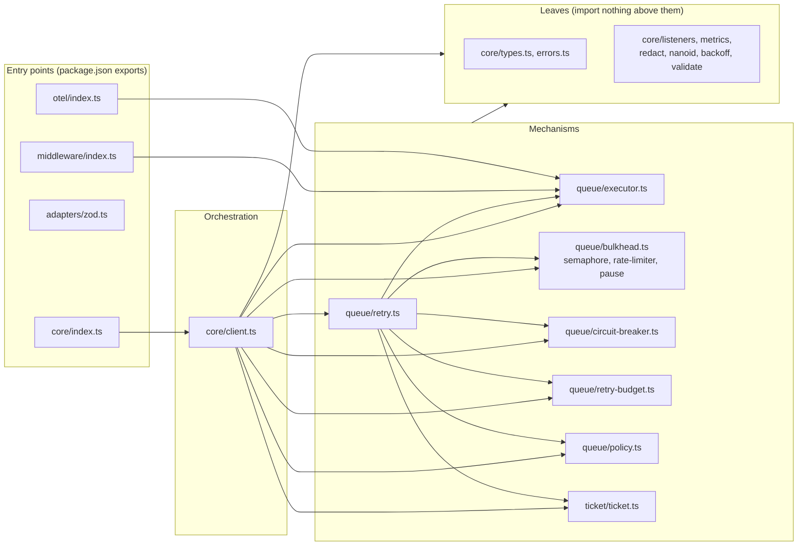

# 2. A map of the repository

> **Crux:** Where does each piece live, and who is allowed to import whom?

Before you follow our request for user 42 through the code, you need to know the terrain:
which directory is the library, which is tooling, and which files are its public face. You also
need the few import rules that no single file states but that the whole package depends on.
Break one and the package either stops loading for some users or ships code it shouldn't.

This chapter is a map. Read the prose once; come back to the tables when you need them.

## The top level

| Path | What it is |
| --- | --- |
| `src/` | The library. Everything that ships to npm comes from here. |
| `test/` | The vitest suite, laid out like `src/`, plus `test/docs/` (checks on the Markdown docs) and `test/types/` (type-level tests). |
| `examples/` | Runnable examples that import the package as a user would. `examples/checkout/` is the README's "one failing dependency" scenario, and it checks its own claims. |
| `performance/` | A separate benchmark and chaos suite with its own `performance/package.json`. It imports `src/` directly. |
| `scripts/` | `scripts/release-prepare.ts` (version bump from the changelog) and `scripts/smoke/` (runs the built package on Deno and Cloudflare's workerd). |
| `docs/` | Hand-written user docs: `docs/guide/` and `docs/operations.md`. This book lives in `docs/book/`. |
| `.github/workflows/` | CI (`.github/workflows/ci.yml`), API-docs deploy (`.github/workflows/docs.yml`), npm release (`.github/workflows/release.yml`), and a bot for claiming good first issues (`.github/workflows/gfi-claims.yml`). |
| `.claude/skills/` | Two agent skills: `guide-me` (an interactive tour) and `update-docs` (a doc-drift checklist). |
| `AGENTS.md` | The densest existing summary of commands, gotchas and invariants. Written for AI agents, useful for humans. |

The build output, `dist`, is gitignored and never edited by hand. The package publishes both
`dist` and `src` (see `files` in `package.json`) so that source maps resolve.

## Inside `src/`

There are 22 files and about 5,050 lines. Most of the weight is in six of them:

| File | Lines | Job |
| --- | --- | --- |
| `src/core/client.ts` | 1,211 | The client: entry point, first attempt, and the wiring of everything else |
| `src/queue/executor.ts` | 496 | One attempt: middleware, `fetch`, timeout, body read, `parse` |
| `src/queue/circuit-breaker.ts` | 452 | The circuit breaker, one per host |
| `src/core/types.ts` | 433 | Public types and default constants |
| `src/queue/retry.ts` | 428 | The retry loop |
| `src/queue/bulkhead.ts` | 346 | The per-host limit on retries, and its queue |

The other sixteen are small, from the validation rules (255 lines) down to the ID generator
(9 lines). Run `wc -l $(git ls-files src)` for the current numbers; they change with every
feature.

### Our request's route through the files

Here is the order in which our request for user 42 touches the big files. Chapter 5 walks the
route in detail; for now, just see where things are.

1. You call `api.get()`. The client, in `src/core/client.ts`, makes a **ticket** (from
   `src/ticket/ticket.ts`) and hands it back.
2. The client checks the request against the rules in `src/core/validate.ts`, then makes the
   first try. The code for one try lives in `src/queue/executor.ts`. Our first try hangs, and
   the executor's timer ends it.
3. The client asks the retry policy (`src/queue/policy.ts`) whether a timeout is worth another
   try. It is, so the request moves to the retry loop in `src/queue/retry.ts`.
4. Each retry waits its turn in the host's queue (`src/queue/bulkhead.ts`), then runs through
   the executor again. The second try gets a 503 and loops; the third gets Ada.
5. Along the way, the client reports events, errors from `src/core/errors.ts` and metrics.

If a breaker, a budget or a rate limit is configured, the client and the retry loop also
consult `src/queue/circuit-breaker.ts`, `src/queue/retry-budget.ts` and
`src/queue/rate-limiter.ts` along the way. Our example configures none of them.

### Who imports whom

The directory names suggest layers, with `core` at the bottom and `queue` above it. The real
shape is different: `src/core/` holds both the bottom of the stack (types, errors, small
utilities) and the top (the client, which wires everything). Here is the import graph,
simplified:



*What to notice: the client is the only file that knows about every mechanism. The mechanisms
know about each other only where the retry loop needs them, and none of them imports the
client.* (The OpenTelemetry file mentions the client's class, but only as a type.)

The small files at the bottom of `src/core/` import only each other. That's what keeps the graph
free of cycles, even though the client and the retry loop both use almost everything.

## The public surface

There are five entry points, declared in the `exports` field of `package.json`:

| Import path | Source file | What it exports |
| --- | --- | --- |
| `@vereda/http` | `src/core/index.ts` | the client, the ticket, `json`, every error class, every `DEFAULT_*` constant, the metric names, `redactUrl`, `defaultRetryPolicy`, `validateConfig`, and the public types |
| `@vereda/http/middleware` | `src/middleware/index.ts` | `defaultHeaders`, `requestLogger`, and the middleware types |
| `@vereda/http/zod` | `src/adapters/zod.ts` | `withZod` |
| `@vereda/http/otel` | `src/otel/index.ts` | `instrumentTracing`, `otelMetricsSink` |
| `@vereda/http/testing` | `src/testing/index.ts` | `faultyFetch` and its option and fault types |

The README's "Versioning and support" section makes the rule explicit: the public surface is
exactly what those five files export. Anything in `src/queue/` or `src/ticket/` that they don't
re-export is internal, even though it ships as readable source. So you may rename a method on
the circuit breaker freely, but renaming a field of a type the entry point re-exports is a
breaking change. Chapter 3 shows how the project handles such changes before 2.0.

## Rules no single file states

These come from AGENTS.md and CONTRIBUTING.md. Each one was checked against the code and the
config.

**Relative imports use the real `.ts` extension.** Every import in `src/` looks like
`from "./types.ts"`. `tsconfig.json` tells the compiler to accept that and rewrite it to `.js`
in the build. Write `"./types.js"` or `"./types"` and the build or the runtime fails.

**Only one file may import each optional dependency.** Only `src/adapters/zod.ts` imports
`zod`, and only `src/otel/index.ts` imports `@opentelemetry/api`. Both are optional peer
dependencies. A user who never imports the Zod entry point may not have Zod installed, so if the
core imported it, the main entry point would fail to load for them. Nothing automated enforces
this rule: no lint rule or test checks it. Review holds it.

**No `node:` imports in `src/`.** This one *is* enforced: a test in
`test/core/emitter.test.ts` reads every file in `src/` and fails if one imports a Node built-in
module. The rule keeps the package loadable on Cloudflare Workers.

**`bun.lock` is the only lockfile.** Install with `bun install`. Running `npm install` writes
an npm lockfile (gitignored) and ignores the pinned versions.

**TypeScript stays on version 6.** TypeScript 7 removed the compiler API that TypeDoc uses for
the API docs. CI runs a non-blocking job against the next version to see when `src/` is ready
for it.

### The typecheck has four legs, not three

`tsconfig.json` drives the build, so it covers only `src/` and leaves the tests out (they
mustn't ship). Everything else needs its own project, and `npm run typecheck` runs them one
after the other:

`package.json` — `typecheck`
```json
"typecheck": "tsc --noEmit && tsc -p tsconfig.test.json && tsc -p examples/tsconfig.json && tsc -p performance/tsconfig.json"
```

That's four legs: the library; the library with its tests and scripts
(`tsconfig.test.json`); the examples (`examples/tsconfig.json`); and the benchmarks
(`performance/tsconfig.json`). AGENTS.md and CONTRIBUTING.md both say "three legs" and leave
out the benchmarks; the script is the truth. If you add a top-level directory of `.ts` files,
add a leg, or nothing typechecks it.

`test/tsconfig.json` exists only so that editors, which look for the nearest file named
`tsconfig.json`, pick up the test settings.

**Biome is the only linter and formatter**, configured in `biome.json`: tabs, 120 columns,
double quotes, and warnings count as errors. The pre-commit hook in `.husky/pre-commit` runs it
on staged files. Never apply Biome's `--unsafe` fixes without reading the diff. They delete
three private methods on the ticket, because Biome can't see that they're reached through
bracket notation. Chapter 4 shows why they're written that way.

## Codemap: where is the thing that does X?

A lookup table. Each row names the file and the function to open first.

| I want to change… | Start in |
| --- | --- |
| What `get()` does before any network call | `src/core/client.ts` — `send` |
| The first attempt and what happens after it fails | `src/core/client.ts` — `_fireFirstAttempt` |
| How config from client, partition and request is merged | `src/core/client.ts` — `mergeRetry`, `mergeTimeout` |
| Config validation and its error messages | `src/core/validate.ts` — `validateConfig` |
| What `close()` accepts | `src/core/validate.ts` — `validateCloseOptions` |
| One attempt: middleware, `fetch`, timeout, body, `parse` | `src/queue/executor.ts` — `executeRequest` |
| The retry loop | `src/queue/retry.ts` — `runRetryLoop` |
| Which errors are retried | `src/queue/policy.ts` — `defaultRetryPolicy` |
| Delay between retries | `src/core/backoff.ts` — `buildBackoffFn`; `src/queue/retry.ts` — `resolveRetryDelay` |
| The ticket's states and events | `src/ticket/ticket.ts` — `Ticket` |
| Per-host queueing | `src/queue/bulkhead.ts` — `Bulkhead` |
| The global concurrency cap | `src/queue/semaphore.ts` — `Semaphore` |
| Rate limiting | `src/queue/rate-limiter.ts` — `TokenBucket`, used by `Bulkhead.takeToken` |
| Pausing a partition after `Retry-After` | `src/queue/pause.ts` — `PartitionPause`, owned by `Bulkhead` |
| Circuit breaking | `src/queue/circuit-breaker.ts` — `CircuitBreaker` |
| Retry budget | `src/queue/retry-budget.ts` — `RetryBudget` |
| The map of per-host objects, and their eviction | `src/queue/partition-registry.ts` — `PartitionRegistry` |
| Error classes | `src/core/errors.ts` |
| Lifecycle events and metrics | `src/core/client.ts` — `emit`, `emitMetrics`; `src/core/metrics.ts` — `METRICS` |
| URL redaction | `src/core/redact.ts` — `redactUrl` |
| Middleware helpers | `src/middleware/index.ts` |
| OpenTelemetry | `src/otel/index.ts` |
| Fault injection for tests | `src/testing/index.ts` |

## Design note: five entry points instead of one

Why not export the Zod and OpenTelemetry helpers from the main entry point? Because a module
that imports `zod` fails to load when `zod` isn't installed, and making Zod a hard dependency
would break the promise of no runtime dependencies. Giving each optional integration its own
entry point means a user pays for it only by importing it.

The middleware helpers have no optional dependency. They live in their own entry point because
they are optional *features*, and `sideEffects: false` in `package.json` lets bundlers drop
what isn't imported. The history doesn't record a deeper reason for that split. The testing
helper (`faultyFetch`) is the same case: no optional dependency, and production code has no
reason to load it.

> **Aside: where the `node:` rule came from.** Until #174 the package used `node:events` and
> `node:crypto`. That PR replaced them with a small internal emitter (`src/core/listeners.ts`)
> and `crypto.getRandomValues` (`src/core/nanoid.ts`) so the package loads on Cloudflare
> Workers, and added both the test that guards the rule and a CI smoke test that runs the
> built package in workerd.

## What must stay true

- Every relative import in `src/` ends in `.ts`.
- Only `src/adapters/zod.ts` imports `zod`; only `src/otel/index.ts` imports
  `@opentelemetry/api`. Not checked automatically.
- No file in `src/` imports a `node:` module (`test/core/emitter.test.ts`).
- The public API is exactly what the five entry-point files export.
- Every directory of `.ts` files is covered by one of the four `npm run typecheck` legs.

## Try it

1. **Check a boundary, and find its hole.** Run `grep -rn '"zod"' src` and
   `grep -rn '@opentelemetry' src`. Each should list exactly one file. Now predict two things,
   then try each with `npx vitest run test/core/emitter.test.ts`, and revert afterwards:
   - Add `import { EventEmitter } from "node:events";` to the top of `src/core/backoff.ts`.
     Does a test fail? (Yes: the case named "src/core/backoff.ts imports no node: builtins".)
   - Replace it with the bare form, `import "node:events";`. Does a test fail? (No. Read the
     regular expression in the test's "runtime portability" block and you'll see why: it looks
     for `from "node:`, `import("node:` and `require("node:`, and a bare import has none of
     those.) If you want a first contribution, tightening that pattern and adding the bare form
     to the test is a small, real one.
2. **Explore the graph.** Pick `src/queue/policy.ts` and list every file that imports it
   (`grep -rln 'policy.ts' src`). Before you look: why would the circuit breaker need the retry
   policy? (It imports the set of retryable error kinds to decide what counts as a failure by
   default. Chapter 9 explains why "worth retrying" and "a failure for the breaker" share a
   definition.)
3. **Trace the route.** Open the five files from "Our request's route through the files" and,
   in each, find the function named in the codemap. You don't need to understand them yet; the
   goal is to have their names in your head before chapter 5.
