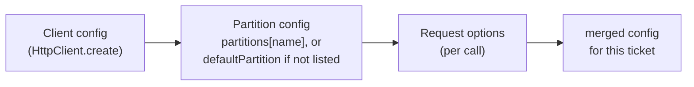

# 3. Using Vereda from the outside

> **Crux:** What does a caller write, how is configuration layered, and what comes back?

You can't reason about the inside until you know what the outside promises. This chapter is a
tutorial: you'll run the book's running example against a real local server, watch our request for
user 42 hang, get a 503 and then succeed, and read every value that comes back.

The chapter then explains how configuration from three levels is merged, because almost every
function in later chapters receives merged config, and you need to know where its values came from.

## Step 1: run our request

Create `scratch.mts` at the repo root (it isn't covered by any typecheck, so it won't bother
CI; delete it when you're done) and paste this in:

```typescript
import { createServer } from "node:http";
import { HttpClient, json } from "./src/core/index.ts";

type User = { id: number; name: string };

// A local upstream having a bad day: the first request hangs,
// the second gets a 503, and every later one succeeds.
let calls = 0;
const server = createServer((req, res) => {
  calls++;
  console.log(`server got #${calls} ${req.method} ${req.url}`);
  if (calls === 1) return; // never answer
  if (calls === 2) {
    res.writeHead(503).end("busy");
    return;
  }
  res.writeHead(200, { "content-type": "application/json" }).end(JSON.stringify({ id: 42, name: "Ada" }));
});
await new Promise<void>((r) => server.listen(0, "127.0.0.1", r));
const { port } = server.address() as { port: number };

const api = HttpClient.create({
  baseUrl: `http://127.0.0.1:${port}`,
  timeout: { attemptMs: 200 },
  retry: { backoff: { baseDelayMs: 50, jitter: false } },
});

api.on("request", (e) => console.log("event request", e.partition, e.method));
api.on("retry", (e) => console.log("event retry", { attempt: e.attempt, delayMs: e.delayMs, kind: e.error.kind }));
api.on("success", (e) => console.log("event success", { attempts: e.attempts, status: e.statusCode }));

const ticket = api.get("/users/42", { parse: json<User>() });
console.log("got a ticket:", ticket.status.state);

const updates = (async () => {
  for await (const u of ticket.subscribe()) console.log("update", u.type);
})();

const result = await ticket.toPromise();
await updates;
if (result.success) {
  console.log("data", result.data.name, "status", result.raw.status);
} else {
  console.log("error", result.error.kind);
}
await api.close();
server.close();
```

The script is the running example with two changes that make its output repeatable: the
waits between tries have no randomness (`jitter: false`), and they start at 50 ms. Chapter 5
runs the same request with the defaults.

Run it with `npx tsx scratch.mts`. You should see this (your port will differ):

```text
event request 127.0.0.1:35633 GET
got a ticket: pending
server got #1 GET /users/42
event retry { attempt: 0, delayMs: 50, kind: 'timeout' }
update queued
update retrying
server got #2 GET /users/42
event retry { attempt: 1, delayMs: 100, kind: 'retryable_status' }
update retrying
server got #3 GET /users/42
event success { attempts: 3, status: 200 }
update done
data Ada status 200
```

## Step 2: read what happened

**The `request` event fired before `get()` returned.** Look at the order: `event request` is
printed before `got a ticket`. `get()` does the first part of the work synchronously, including
choosing where the request belongs and announcing it, and only then hands you the ticket.
Chapter 5 shows why.

**The partition is `127.0.0.1:35633`.** A **partition** is the group of requests that share one set
of limits, usually one host. You didn't name one, so Vereda used the URL's host, including the port
when it isn't the scheme's default.

Every partition gets its own queue for retries and, if you configure them, its own circuit breaker,
retry budget and rate limiter.

**The first try timed out after 200 ms.** The server never answered, and the per-attempt timeout
ended the try. A timeout is worth another try, so the first `retry` event says
`kind: 'timeout'`.

**The second try got a 503.** That status is on the default list of ones worth retrying, so the
second `retry` event says `kind: 'retryable_status'`.

**The waits were 50 ms, then 100 ms.** Each wait doubles: 50 × 2⁰, then 50 × 2¹. With the
default randomness switched on, each would be a random value between zero and that number.
Chapter 7 explains why randomness is the default.

**The retry event's `attempt` starts at 0, and it means "the first retry".** Elsewhere the
library counts differently: a custom retry rule (chapter 7) gets 0 for the first *try*. This is
a known wart, planned to be fixed in 2.0.

**The ticket went `pending`, `queued`, `retrying`, `retrying`, `done`.** Those are the ticket's
states: it waited for its first retry, ran two retries, and finished. Chapter 4 covers them.

**`data` is typed `User`** because you passed `parse: json<User>()`. `json` is a one-line
function that casts without checking. With a real validator (or the Zod adapter), a body of
the wrong shape becomes a validation error.

**`raw` is the `Response`.** It's always there on success, so you can read headers.

> **Aside: why `server.close()` matters, and a trap.** Every timer Vereda creates is
> `unref()`'d, so the library never keeps a Node process alive by itself
> ([operations guide](../operations.md), "Shutdown sequence"). In this script the server keeps
> the process alive. Replace the server with a fake `fetch`, as the README's running example
> does, and the script can exit in the middle of a backoff with "Detected unsettled top-level
> await": nothing holds the event loop while the retry sleeps. That's why the README's version
> keeps an empty `setInterval` running. Real services always have something holding the loop
> (a server, a queue consumer), so this only bites in one-off scripts. The test suite never
> hits it because vitest keeps the process alive.

## The shape of the API

### Verb methods

The client has one method per HTTP verb. `get`, `head`, `options` and `delete` take a URL and
options; `post`, `put` and `patch` also take a body; and `request` takes a URL and options that
name the method. They all call one private method, `send`, which chapter 5 reads line by line.
Here is one of them:

`src/core/client.ts` — `post`
```typescript
post<T>(
	url: string,
	body?: BodyInit | (() => BodyInit),
	options: Omit<RequestOptions<T>, "method" | "body"> = {},
): Ticket<T> {
	return this.send(url, { ...options, method: "POST", body });
}
```

Each method has three overloads, and they decide the type of `data`:

| You pass | `data` is typed as |
| --- | --- |
| `parse: fn` | whatever `fn` returns (awaited if it's async) |
| `responseType` but no `parse` | `unknown` for `"json"`, `string` for `"text"`, `ArrayBuffer`, `Blob`, or `undefined` for `"none"` |
| neither | `undefined`, and the body is left unread on `raw` |

The type that maps a response type to its data type is `BodyOf`, in `src/core/types.ts`. Note
that JSON without `parse` gives `unknown`, not `any`: decoded but unchecked data has to be
narrowed before you trust it.

The body can also be a function that returns a body. The client calls it once per try, so every
retry gets a fresh body. A raw stream can be read only once, so passing one directly fails the
request with a configuration error; wrap it in a function instead.

### The result

`src/core/types.ts` — `Result`
```typescript
export type Result<T> = { success: true; data: T; raw: Response } | { success: false; error: AppError };
```

The error side is a union of twelve error classes from `src/core/errors.ts`. Each has a fixed `kind`
string (`"network"`, `"http"`, `"timeout"`, `"max_retries"`, and so on), so a `switch` on it tells
TypeScript which class you have.

A minor release may *add* a class, so the docs recommend ending such a `switch` with a `default`
branch rather than a compile-time check that every case is covered.

The full table of errors is in [docs/guide/results-and-errors.md](../guide/results-and-errors.md);
chapter 7 explains the ones the retry logic produces.

## How configuration is layered

There are three levels of configuration, and most settings can be set at more than one:



_What to notice: a listed partition replaces `defaultPartition`; it doesn't inherit from it._

For our request, the client sets the timeout and the backoff, no partition is configured, and
the request sets only `parse`. The merge itself is plain object spread, one level deep:

`src/core/client.ts` — `mergeRetry`
```typescript
private mergeRetry(options: RequestOptions<unknown>, partitionName?: string): RetryConfig {
	const partitionConfig = partitionName ? this.partitionConfig(partitionName) : undefined;
	return {
		...this.config.retry,
		...partitionConfig?.retry,
		...options.retry,
	};
}
```

Its twin for timeouts, `mergeTimeout`, works the same way. Two consequences follow:

- Merging works **field by field** inside the retry settings (and inside the timeout settings).
  A request that sets only `retry: { maxRetries: 1 }` keeps the partition's backoff and the
  client's list of retryable statuses.
- Merging is **not deep**. The backoff is one field: a request's
  `backoff: { baseDelayMs: 10 }` replaces the partition's whole backoff object, so its cap and
  jitter fall back to the defaults, not to the partition's values.

The partition lookup (`partitionLookup` in `src/core/types.ts`) returns the listed partition if
there is one, and `defaultPartition` otherwise. It checks for an *own* property, so a partition
named `constructor` or `toString` doesn't pick up a method from `Object.prototype`.

Not every setting exists at every level:

| Setting | Client | Partition | Request |
| --- | --- | --- | --- |
| `retry`, `timeout` | yes | yes | yes |
| `circuitBreaker` | yes (default for all partitions) | yes (field by field) | no |
| `retryBudget`, `rateLimit`, `pauseOnRetryAfter` | yes (default for all partitions) | yes (field by field), or `false` to opt out | no |
| `concurrency`, `maxQueueSize` | yes, but means the **global** cap | yes, means the **per-partition** retry limit | no |
| `limitFirstAttempts` | no | yes | no |
| `partition` (which partition to use) | no | n/a | yes |

Two rows need a word.

The `concurrency` row is the one to remember. On the client, `concurrency` (default 50) caps
how many tries run at once across all hosts. On a partition, `concurrency` (default 5) caps how
many *retries* run at once for that host. Same name, two different mechanisms; chapter 8
explains both.

The `false` in the budget, rate-limit and pause row lets one partition turn off a limit set on the
client. Say the client sets a rate limit for every host, but one internal host is cheap to call and
shouldn't be limited: give that partition `rateLimit: false`.

Merging can't express this on its own, since spreading `false` into an object adds nothing, so the
code checks for `false` before it merges. Any other value that isn't an object fails validation.

## Validation: throw early, or fail the ticket

Bad configuration is caught in two places, and they behave differently:

- **Creating the client** runs `validateConfig` from `src/core/validate.ts`, which *throws* a
  configuration error. A client with bad config never exists.
- **A request's own options** (its timeout, retry settings, method, response type, body, and
  whether its URL resolves) are checked as the request starts, and a problem *fails the ticket*
  with a configuration error. The call itself doesn't throw.

Why the split? `toPromise()` never rejects, and a verb method that sometimes threw would give
callers two error channels to handle.

Config passed when creating the client is checked once at startup, where a throw is the clearest
signal. Per-request mistakes go through the same result channel as everything else, and they're
never retried: an unresolvable URL is the caller's mistake, not a network fault.

Three cases sit at the edges of that rule:

- **A closed client.** Calling any verb method after `close()` throws "client closed" at once,
  because there's no ticket worth returning.
- **Closing with bad options.** `close()` returns a promise, so it reports bad options by
  rejecting. If you ask it to wait for in-flight requests, it needs a time limit, and that limit
  must be a finite number of milliseconds that a timer can actually hold (at most
  2,147,483,647). A rejected `close()` leaves the client open, so you can call it again with a
  corrected limit.
- **A signal that's already aborted.** If you pass an `AbortSignal` that has already fired, the
  request ends as cancelled before any of its checks run, with a single `cancelled` event and no
  `request` event. Cancellation wins even over a mistake in the request.

Every numeric check in `src/core/validate.ts` is written so that `NaN` fails it. The file's
opening comment explains why: `NaN <= 0` is false, so the obvious check would accept `NaN`,
and `attemptMs: NaN` would silently mean "no timeout".

> **Aside: the history of those three edges.** The last two were bugs fixed in October 2026.
> Before #198, `close()` accepted `Infinity` as its drain limit, Node fired the timer after
> 1 ms, and in-flight requests were cancelled instead of drained (chapter 1 described that
> trap). Before #196, a pre-aborted request that also had a bad URL reported a `failure` event
> while its ticket said "cancelled". Chapter 11 tells both stories.

## Changing the public API before 2.0

Chapter 2 said the public API is what the five entry points export. Changing it in a compatible way
is easy: add things. Removing or renaming something has to wait for 2.0.

Until then, the project **deprecates** it: the old form keeps working, the new form exists beside
it, and the changelog says what will change. These are the deprecations so far:

| Today (1.x) | Use instead | What 2.0 changes |
| --- | --- | --- |
| a bulkhead snapshot's `name` (from `partitions()`, chapter 8) | its `partition` field (same value) | `name` is removed |
| a full global queue reported as partition `"global"` | the error's `scope` field: `"partition"` or `"global"` | `partition` is absent for the global queue |
| a `circuitBreaker` config without `enabled: true` does nothing | pass `enabled` explicitly | setting `circuitBreaker` turns the breaker on |

The second row fixes a real ambiguity: a partition may itself be named `"global"`, so the name
alone can't say which queue was full. The third row makes the breaker behave like the retry
budget and the rate limiter, which are on as soon as you configure them.

> **Aside: where these are tracked.** The 2.0 plan lives in issue #148, which began with the
> attempt-numbering wart from Step 2. The deprecations above landed in #189, and the
> `CHANGELOG.md` section "Deprecated" lists them. The deprecated field carries an
> `@deprecated` tag, so editors strike it through.

## Design note: a ticket, not a promise

Why doesn't `get()` return a promise of a result? Because a request in Vereda has a life of its own:
it can wait in a queue, be retried and be cancelled, as ours was retried twice. A promise can only
say "done".

The ticket can be cancelled, observed while it runs (as the script did with `subscribe()`), and
still turned into a promise with `toPromise()`. The ONBOARDING guide puts it as "this is why Vereda
returns a ticket instead of a plain promise".

The history doesn't record other designs that were considered; the ticket is in the first "core
features" commit.

## What must stay true

- Verb methods never throw, except after `close()`. Every other problem reaches the caller as a
  result with `success: false`.
- Creating a client throws on invalid config; request-level problems become configuration
  errors on the ticket and are never retried.
- Config merges client → partition (or `defaultPartition`) → request, one level deep, field by
  field inside the retry and timeout settings. A partition's `false` turns off the client's
  budget or rate limit.
- The default partition name is the URL's host (hostname, plus the port when it isn't the
  default).
- A rejected `close()` leaves the client open.
- Public names are deprecated in 1.x and removed only in 2.0.

## Try it

Add these to `scratch.mts` after the first example. Create a new client for them, since the
first one is closed. The exercises that use a fake `fetch` need something to hold the event
loop: add `const keep = setInterval(() => {}, 1000);` before them and `clearInterval(keep)`
after.

1. **Predict, then run.** With no `baseUrl`, what does `client.get("/relative").toPromise()`
   resolve to? (A `configuration` error with the message
   `Invalid configuration: url /relative must be absolute when no baseUrl is set`. No `request`
   event fires, because no partition was chosen.)
2. **Predict, then run.** What about
   `client.get("http://x.test/", { timeout: { attemptMs: -5 } })`? And
   `HttpClient.create({ timeout: { attemptMs: 1000 }, concurrency: 0 })`? And
   `client.close({ drain: true, timeoutMs: Infinity })`? (The first resolves to `configuration`
   with `request.timeout.attemptMs must be positive`. The second *throws*
   `Invalid configuration: concurrency must be a positive integer`. The third *rejects* with
   `Invalid configuration: close({ drain: true }) requires a finite, positive timeoutMs`, and
   the client still accepts requests afterwards.)
3. **Work out the merge.** A fake `fetch` always returns `503`. The client sets
   `retry: { maxRetries: 5 }`,
   `partitions: { "x.test": { retry: { backoff: { baseDelayMs: 1, jitter: false } } } }` and
   `defaultPartition: { retry: { maxRetries: 0 } }`. How many times is `fetch` called for
   (a) `get("http://x.test/", { retry: { maxRetries: 1 } })`, (b) `get("http://x.test/")`, and
   (c) `get("http://other.test/")`? (Answers: (a) 2, ending in `max_retries`; (b) 6, because
   the listed partition doesn't inherit `defaultPartition`, so the client's 5 applies; (c) 1,
   ending in a plain `retryable_status`, because `defaultPartition` allows no retries. (c)
   would use the default 200 ms backoff, but it never waits.)
4. **Opt one host out.** A fake `fetch` always answers `200`. The client sets
   `rateLimit: { tokensPerSec: 1, burst: 1, maxWaitMs: 0 }` and
   `partitions: { "internal.test": { rateLimit: false } }`. Send three quick `GET`s to
   `http://api.test/users/42`, then three to `http://internal.test/users/42`, and print each
   result's `kind` (or `ok`). (Answer: `ok rate_limited rate_limited` for `api.test`, which
   gets one token per second and may not wait; `ok ok ok` for `internal.test`. Then print
   `client.partitions()`: `api.test` reports its free `tokens`, a number near 0, while
   `internal.test` reports none, because it has no rate limiter.)
