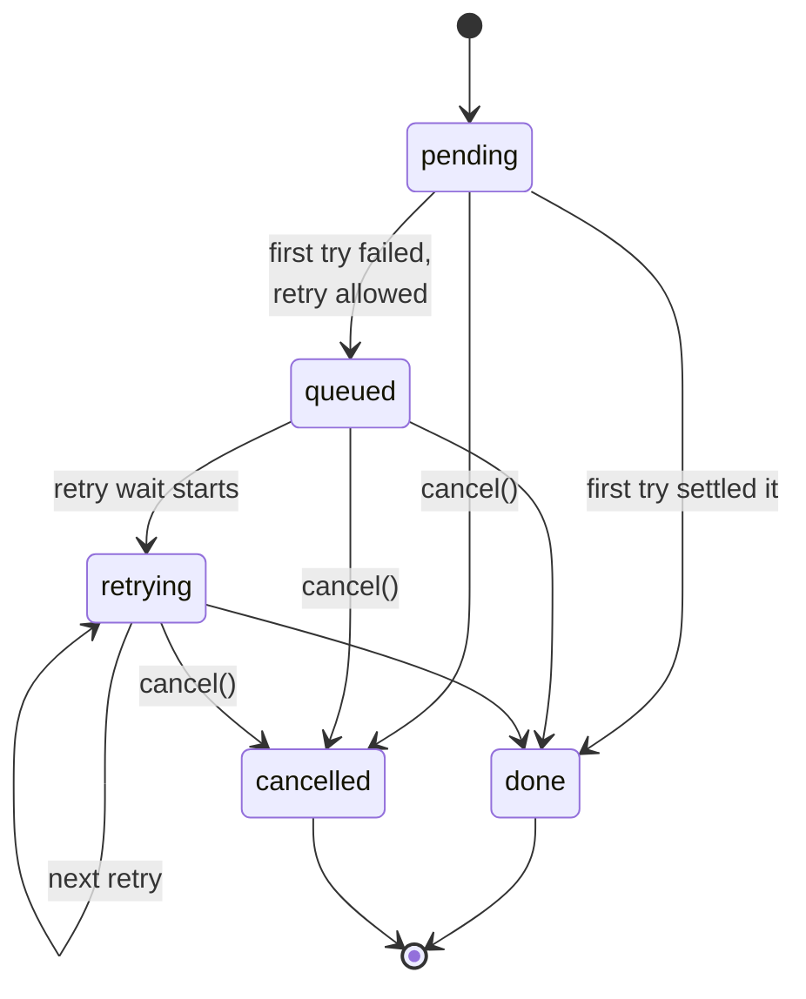

# 4. The ticket

> **Crux:** Why does a request return a `Ticket` instead of a promise, and what states can it be in?

When you call `api.get("/users/42")` in the running example, you don't get a promise back. You get a
**ticket**: an object you can await, watch and cancel.

The library keeps a second handle to the same object, which it uses to move the ticket from state to
state and finally to settle it with a result. Chapter 5 is written in terms of these two handles, so
this chapter comes first.

Without a ticket, Vereda would need a separate mechanism for each of four jobs: waiting for the
result, cancelling, watching progress, and stopping network work that's already running. The
ticket does all four. It is also built so that only the library, never your code, decides how a
request ends.

## Our ticket's life

Here are the ticket updates from one run of the running example. The first column is
milliseconds since the call. The waits are random, so your numbers will differ, and so will
chapter 5's.

```text
    3  get() returns the ticket   pending
  206  update                     queued      (attempt 1 timed out; a retry is coming)
  213  update                     retrying    round 0, wait 86 ms
  313  update                     retrying    round 1, wait 79 ms
  394  update                     done        success, {"id":42,"name":"Ada"}
```

Every ticket follows the same small map of states:



*What to notice: `done` and `cancelled` are both final, and only `cancel()` reaches `cancelled`.
Our request took the path pending → queued → retrying → retrying → done.*

## Two handles to one object

The ticket class lives in `src/ticket/ticket.ts`. The part you see as a caller is small:

| You want to… | Use |
| --- | --- |
| wait for the result | `toPromise()`, which never rejects |
| know where it is now | `status` |
| stop it | `cancel()` |
| watch it | `on("update")`, or `for await` over `subscribe()` |
| stop your own work along with it | `signal`, an `AbortSignal` |

The methods that *change* the state are private. The only way to reach them is the second
handle, the **controller**, which a factory function returns next to the ticket:

`src/ticket/ticket.ts` — `createTicket`
```typescript
export function createTicket<T>(id: string): {
	ticket: Ticket<T>;
	controller: TicketController<T>;
} {
	const ticket = new Ticket<T>(id);

	const controller: TicketController<T> = {
		// Bracket notation accesses private methods — the type boundary prevents
		// external callers from reaching these, while the controller provides
		// a clean compile-time API for internal use.
		// ...
		markQueued: () => ticket["markQueued"](),
		markRetrying: (attempt, delayMs) => ticket["markRetrying"](attempt, delayMs),
		markDone: (result) => ticket["markDone"](result),
		abortSignal: () => ticket["_abortController"].abort(),
		// ...
	};

	return { ticket, controller };
}
```

TypeScript lets bracket access reach a private member, so this compiles. Your code, holding only
the ticket, gets a compile error if it tries to mark it done. The factory isn't exported from the
package, so only the client creates tickets, and only the client holds controllers.

> **Aside: the linter that deletes this.** Biome's `--unsafe` fix sees three private methods
> that are never called with a dot, decides they're unused, and deletes them. Each carries a
> `biome-ignore` comment saying why it must stay.

## Every change goes through one check

The allowed moves are written down as a table, and every state change asks it first:

`src/ticket/ticket.ts` — `ALLOWED_TRANSITIONS`, `applyTransition`
```typescript
const ALLOWED_TRANSITIONS: Record<TicketStatus["state"], TicketStatus["state"][]> = {
	pending: ["queued", "done", "cancelled"],
	queued: ["retrying", "done", "cancelled"],
	retrying: ["retrying", "done", "cancelled"],
	cancelled: [],
	done: [],
};
// ...
private applyTransition(next: TicketStatus): boolean {
	if (!ALLOWED_TRANSITIONS[this._status.state].includes(next.state)) {
		return false;
	}
	this._status = next;
	return true;
}
```

A move that isn't allowed is **ignored**, not thrown. That's a safety net, and it matters most
at the end. If your `cancel()` and a finishing attempt race, whichever arrives second finds the
ticket already final and does nothing. So a ticket settles exactly once, and its promise resolves
exactly once.

Each allowed move emits an `update`. Settling as done also emits `done`, and for a failure
`error`, and then resolves the promise:

`src/ticket/ticket.ts` — `markDone`
```typescript
private markDone(result: Result<T>): void {
	if (!this.applyTransition({ state: "done", result })) return;
	this.emitter.emit("update", { type: "done", result } as TicketUpdate);
	this.emitter.emit("done", result);
	if (result.success === false) {
		this.emitter.emit("error", result.error);
	}
	this._resolve(result);
}
```

## Cancelling

Suppose that at 250 ms, while our request sleeps before its second retry, you lose interest and
call `ticket.cancel()`. Cancelling does more than change the state. It settles the ticket right
away, without waiting for anything in flight to notice:

`src/ticket/ticket.ts` — `cancel`
```typescript
cancel(): void {
	if (this._cancelled) return;
	// `cancelled` is terminal — if the ticket already resolved, this is a no-op.
	if (!this.applyTransition({ state: "cancelled" })) return;
	this._cancelled = true;
	this._abortController.abort();
	const result: Result<T> = { success: false, error: new CancelledError() };
	this.emitter.emit("update", { type: "cancelled" } as TicketUpdate);
	this.emitter.emit("done", result);
	this.emitter.emit("error", result.error);
	this._resolve(result);
}
```

Read it in order:

1. A ticket that's already done can't be cancelled. The transition check refuses, and the call
   does nothing.
2. The ticket's own abort controller fires. Every attempt and every wait in the library listens
   to the ticket's signal, so the sleep before the next retry ends at once.
3. The ticket resolves with a `CancelledError` immediately. Your `await` returns now, not when
   the library's internals have wound down.

Point 3 has a cost inside the library. When the interrupted work finally returns, the code that
handles it will try to settle the ticket and announce how it ended. Settling is safe, because the
transition check ignores it.

But the client's own `cancelled` event must still fire exactly once, so that code has to ask the
ticket first whether it's already over. The next two sections are about how it asks.

### Cancelled before it started

You can also cancel before the request exists: pass an `AbortSignal` that has already fired. The
client then cancels the ticket inside `get()`, before handing it to you.

When the first attempt starts a moment later, the first thing it does is ask whether the ticket is
already settled. If so, it announces one `cancelled` event and stops. No `request` event fires and
nothing is fetched; `get()` returns a ticket that is already `cancelled`.

`src/core/client.ts` — `_fireFirstAttempt`
```typescript
if (ticket.isSettled) {
	this.emit("cancelled", {
		ticketId: ticket.id,
		url: this.logUrl(url),
		partition: this.tryResolvePartition(url, options),
		attempts: 1,
		durationMs: Date.now() - startTime,
		queuedMs: 0,
	});
	cleanup();
	return;
}
```

Two details in the event are worth knowing. It reports `attempts: 1` even though nothing was
sent, like every other early exit. And if the URL can't be resolved, its partition is
`undefined`. That's the one case where a `cancelled` event has no partition.

> **Aside: the bug this fixed (#196).** Before this check, a pre-aborted ticket ran through the
> first attempt's checks anyway. If one of them failed (a bad URL, an open circuit breaker), the
> client emitted `failure` for a ticket whose result was already `CancelledError`, so listeners
> and the caller saw different endings. A guard on each early exit was the alternative; one check
> at the top also covers early exits added later.

### Deadline: abort without cancelling

The controller has a fourth method, `abortSignal()`, which fires the ticket's signal *without*
cancelling it. The overall deadline (`timeout.totalMs`) uses it. In-flight work stops just as it
does for a cancel, but the ticket stays `pending`, `queued` or `retrying`, and it isn't marked
cancelled. The code that sees the attempt end then asks one question to tell the two apart:

```typescript
if (!ticket.isCancelled && isBoundedMs(timeoutConfig.totalMs)) {
	// the deadline fired: fail with DeadlineExceededError
} else {
	// the caller cancelled: emit "cancelled"
}
```

This check appears in three places, one in the client and two in the retry loop. If you add a
fourth place where an attempt can end, it needs the same check.

### The two questions

`src/ticket/ticket.ts` — `isCancelled`, `isSettled`
```typescript
get isCancelled(): boolean {
	return this._cancelled;
}

/** True once this ticket has reached a terminal state by any path — a
 *  normal `done` transition or `cancel()` (which resolves the ticket
 *  directly, bypassing `done`). A terminal-event emitter must check this
 *  before firing, or a result racing a concurrent cancel() can emit a
 *  second, contradictory terminal event for the same ticket. */
get isSettled(): boolean {
	return this._status.state === "done" || this._cancelled;
}
```

The first asks "did the *caller* end this?". The second asks "is it over, by any path?". Ask the
second before announcing an ending from a catch-all path, as the pre-aborted check above does.
Ask the first to choose between "cancelled" and "deadline exceeded".

## Watching a ticket

There are two ways to watch. A plain listener, `on("update", fn)`, is called for each change.
The other is an async generator, so you can write `for await (const u of ticket.subscribe())`.
It keeps updates in a list and wakes a waiting loop when a new one arrives:

`src/ticket/ticket.ts` — `subscribe`
```typescript
async *subscribe(): AsyncGenerator<TicketUpdate> {
	// Already terminal — yield synthetic update and return
	const current = this._status;
	if (current.state === "done") {
		yield { type: "done", result: current.result };
		return;
	}
	// ... same for "cancelled"
	const updates: TicketUpdate[] = [];
	let notify: (() => void) | null = null;
	let isDone = false;
	const onUpdate = (update: TicketUpdate) => {
		updates.push(update);
		notify?.();
		notify = null;
		if (update.type === "done" || update.type === "cancelled") {
			isDone = true;
		}
	};
	this.emitter.on("update", onUpdate);
	try {
		while (!isDone || updates.length > 0) {
			if (updates.length > 0) {
				yield updates.shift()!;
			} else {
				await new Promise<void>((r) => {
					notify = r;
				});
			}
		}
	} finally {
		this.emitter.off("update", onUpdate);
	}
}
```

Two parts matter. The early return at the top means a subscriber who arrives after the end still
gets one final update, instead of waiting forever. And the `finally` removes the listener even
if you break out of the loop early.

## Listener errors can't break the ticket

The ticket's events go through a small emitter in `src/core/listeners.ts`, used instead of
Node's. It calls every listener inside a `try`, and passes anything thrown to one function:

`src/core/listeners.ts` — `reportCallbackError`
```typescript
export function reportCallbackError(err: unknown): void {
	queueMicrotask(() => {
		throw err;
	});
}
```

The error is thrown again on a fresh microtask. It still reaches your process's
`uncaughtException` handler, like a throw from any other listener, but it can't unwind into the
code that was settling the ticket. Without this, a `done` listener that threw would stop
`markDone` before it resolved the promise, and your `await` would wait forever.

The client uses the same function for every piece of your code it calls on the side: lifecycle
listeners, the metrics sink and, on current `main`, the logger. A logger that throws on "Request
succeeded" can't turn our successful request into a failure.

> **Aside: history.** The stuck-promise bug was B2, fixed in #87. Logger isolation came later
> (#197, fixed in #200): a logger that threw on "Request succeeded" turned a 200 into a failed
> ticket, and both `success` and `failure` fired for it.

## Design note: why `cancel()` settles the ticket itself

The alternative is for `cancel()` only to fire the signal, and to let the running attempt notice and
settle the ticket through the normal path. That gives one code path for every ending.

Vereda settles inside `cancel()` instead, so your promise settles at once even when the transport is
slow to give up. The cost is everything in the "Cancelling" section: every other ending has to check
whether `cancel()` got there first.

How much that cost matters showed up when a custom `fetch` ignored the abort signal. `cancel()`
resolved the ticket, but the attempt never returned, so the client's `cancelled` event never fired.

The fix left `cancel()` alone and made attempts end on abort whatever the transport does (chapter
6). The pull request notes that making `cancel()` emit the event itself was considered and rejected,
because "that fixes only the event, while the same root cause also broke `attemptMs`/`totalMs`"
(#181).

## What must stay true

- Only code holding the controller can change a ticket's state. The changing methods stay
  private.
- `done` and `cancelled` are final. A move the table doesn't allow is ignored, so a ticket
  settles exactly once.
- `cancel()` on a finished ticket does nothing. On a live one it resolves the ticket at once
  with `CancelledError` and fires its signal.
- A deadline fires the signal through the controller and never marks the ticket cancelled.
- Code that announces an ending from a catch-all path asks `isSettled` first. A pre-cancelled
  ticket gets exactly one `cancelled` event and no `request` event.
- A throwing listener or logger never stops a ticket from settling.

## Try it

The factory isn't public, but you can import it from source in a scratch file at the repo root:
`import { createTicket } from "./src/ticket/ticket.ts";`

1. **Predict, then run.** Create a ticket, attach `update`, `done` and `error` listeners that
   log, then call, in order: `controller.markRetrying(0, 10)`, `controller.markQueued()`,
   `ticket.cancel()`, and `controller.markDone({ success: true, data: "x", raw: new Response("x") })`.
   What's logged, and what does `toPromise()` resolve to? (Answer: the first call is an illegal
   move from `pending` and is silent. Then `update queued`, `update cancelled`, `done false`,
   `error cancelled`. The late `markDone` does nothing. The result is a `cancelled` error.)
2. **Predict, then run.** Create a ticket and call only `controller.abortSignal()`. What are
   `status.state`, `isCancelled`, `isSettled` and `signal.aborted`? (Answer: `pending`, `false`,
   `false`, `true`. This is exactly what the retry loop sees after a deadline.)
3. **Predict, then run.** In the running example, pass an already-aborted signal:
   `const ac = new AbortController(); ac.abort();` and
   `api.get("/users/42", { signal: ac.signal })`. Which client events fire, does the fake server
   see a call, and what is `ticket.status` when `get()` returns? (One `cancelled` event with
   `attempts: 1`; no `request` event; no fetch; `cancelled`.)
4. **Change + test.** Add a test to `test/ticket/ticket.test.ts` asserting that a throwing
   `done` listener doesn't stop `toPromise()` from resolving. Register
   `process.on("uncaughtException", …)` in the test, and remove it afterwards, so the rethrown
   error doesn't fail the run. Then see whether `test/core/callback-isolation.test.ts` already
   covers this case; if it does, compare your version with it.
