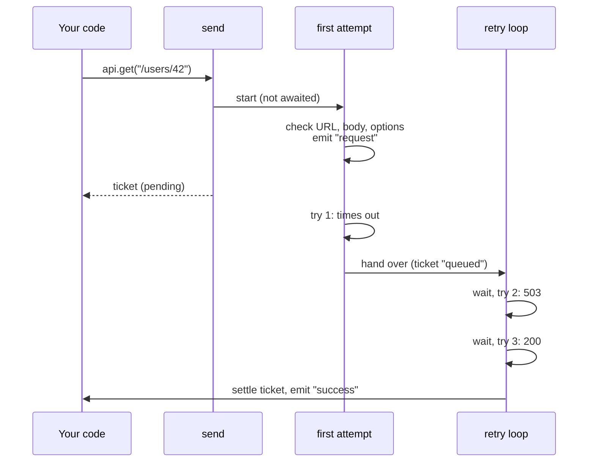
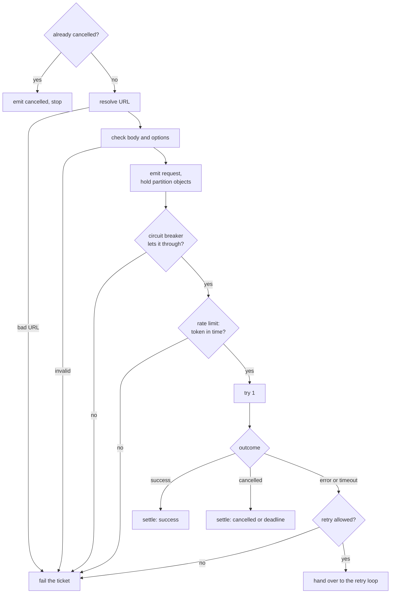

# 5. Life of a request

> **Crux:** What happens, step by step, between `client.get()` and the ticket settling?

This is the backbone of the book. Every later chapter opens one box from this chapter. To keep
it concrete, we follow one request the whole way: the book's running example.

## Our request

You ask for user 42. The server is having a bad day: the first try hangs, the second answers
`503 Service Unavailable`, and the third works.

```typescript
const api = HttpClient.create({
  baseUrl: "https://api.example.com",
  timeout: { attemptMs: 200 },
  fetch: fakeServer, // hangs, then 503, then 200 with {"id":42,"name":"Ada"}
});

const ticket = api.get("/users/42", { parse: json<User>() });
const result = await ticket.toPromise();
```

Here is what really happens when you run it (the README has the full script), condensed to one
line per client event and ticket update. The first column is milliseconds since the call; your
times will differ a little.

```text
    6  event request         partition api.example.com
    7  get() returns the ticket (pending)
   20  fetch #1              ...hangs
  210  update queued         attempt 1 timed out after 200 ms
  212  event retry 0         wait 4 ms, because of: timeout
  217  fetch #2              → 503
  224  event retry 1         wait 281 ms, because of: retryable_status
  507  fetch #3              → 200
  513  event success         attempts: 3
  513  update done           data: {"id":42,"name":"Ada"}
```

By the end of this chapter you'll be able to explain every line, including two that look odd:
why the `request` event fires *before* `get()` returns, and why the two waits are so different.

## Three stages

The client's work splits into three functions, and our request passes through all three:

1. **`send`** runs inside your call to `get()`. It makes the ticket and hands it back.
2. **`_fireFirstAttempt`** checks the request, makes the first try, and decides what happens
   next. For our request, that first try times out.
3. **`runRetryLoop`** (in `src/queue/retry.ts`) makes every later try, until one of them
   settles the ticket. Our request needs two more.



*What to notice: you get the ticket back while the first try is still running. Everything after
that happens in the background, and you hear about it through events and the ticket.*

## Stage 1: the call returns a ticket

All the verb methods (`get`, `post` and the rest) call the same private method, `send`. Here it
is with the comments trimmed:

`src/core/client.ts` — `send`
```typescript
private send<T>(url: string, options: RequestOptions<T>): Ticket<T> {
	if (this._closed) {
		throw new ConfigurationError("client closed");
	}

	const startTime = Date.now();
	const ticketId = nanoid();
	const { ticket, controller } = createTicket<T>(ticketId);

	let externalAbortListener: (() => void) | undefined;
	if (options.signal) {
		if (options.signal.aborted) {
			ticket.cancel();
		} else {
			externalAbortListener = () => ticket.cancel();
			options.signal.addEventListener("abort", externalAbortListener, { once: true });
		}
	}
	// ... cleanupExternalSignal removes that listener

	const timeoutConfig = this.mergeTimeout(options, this.tryResolvePartition(url, options));
	let deadlineTimer: ReturnType<typeof setTimeout> | undefined;
	// ... cleanupDeadline clears it
	if (isBoundedMs(timeoutConfig.totalMs)) {
		deadlineTimer = setTimeout(() => {
			controller.abortSignal();
		}, timeoutConfig.totalMs);
		deadlineTimer.unref?.();
	}
	// ... inflight entry and cleanup (below)
	this._inflightTickets.add(entry);

	this._fireFirstAttempt(/* ... */).catch((err: unknown) => {
		// ... backstop (below)
	});

	return ticket;
}
```

Read it top to bottom. Before any network work, four things happen.

**Your abort signal becomes a cancel.** If you passed an `AbortSignal` and it fires, the ticket
is cancelled, exactly as if you'd called `cancel()` yourself. If it had fired already, the ticket
is cancelled right here, before you get it. Our request has no signal, so this does nothing.

**The total deadline starts now.** If the request has an overall time limit (`totalMs`), its
timer starts at the call, not at the first byte. When it fires, it aborts the ticket's signal
without marking the ticket cancelled. That difference lets later code report "deadline
exceeded" instead of "cancelled". Our request sets only a per-attempt limit, so no deadline timer
starts.

> **Aside: two fixes in these lines.** The abort listener is removed when the ticket ends. Before
> #7, a long-lived signal shared by many requests collected one listener per request. And the
> deadline is merged with the *partition's* settings, found by `tryResolvePartition`. Before #88
> it ignored them, so a `totalMs` set for one host was silently dropped (bug B4).

**The ticket is registered for shutdown.** The client keeps a set of in-flight tickets so that
`close()` can find them. Each entry has a cleanup function that undoes everything this ticket
took:

`src/core/client.ts` — `send` (the cleanup closure)
```typescript
entry.cleanup = () => {
	cleanupExternalSignal();
	cleanupDeadline();
	// Take-and-clear so the holds are released exactly once even though
	// cleanup runs on several paths (terminal state, shutdown, catch).
	const release = entry.release;
	entry.release = undefined;
	release?.();
	if (this._inflightTickets.delete(entry) && this.metrics) {
		try {
			this.metrics.gauge(METRICS.IN_FLIGHT, this._inflightTickets.size);
		} catch (err) {
			reportCallbackError(err);
		}
	}
};
```

Many paths call cleanup: every ending, the safety net below, and `close()`. So it's harmless
the second time. The "take and clear" in the middle is the trick: whoever calls first gets the
release function, and everyone after gets nothing. Chapters 8 and 9 reuse this pattern.

**The first attempt starts, but `send` doesn't wait for it.** `_fireFirstAttempt` is an async
function, and `send` calls it without `await`, then returns the ticket. The `.catch` on the end
is a safety net. It should never run, because the first attempt handles its own errors. If
something unexpected throws anyway, the safety net settles the ticket as a failure, but only if
nothing has settled it yet, so a crash racing a `cancel()` can't produce a second ending.

### Why `request` fires before `get()` returns

Look at the first two lines of the timeline: `event request` at 6 ms, then `get()` returns at
7 ms. How can the client announce the request before you have the ticket?

An async function runs synchronously until its first `await`. Everything the first attempt does
before sending (resolving the URL, checking the body and options, emitting `request`, checking
the circuit breaker) happens *inside* your call to `get()`. Only when it reaches the first
`await` does control come back to `send`, which returns the ticket.

One consequence: a `request` listener runs before your code holds the ticket. It can use the
ticket's id, which is in the event, but not the ticket object.

## Stage 2: the first attempt

`_fireFirstAttempt` is the longest function in the library. Its shape, though, is simple: a
row of checks, then one try, then a fork.



*What to notice: there are many ways to end before the retry loop, and one way in. Our request
takes the long path down the middle and out at the bottom right.*

### The checks, and the shape of every early exit

The very first check is for a ticket that's already over, which can only mean a signal that had
fired before you called `get()`. Such a ticket gets one `cancelled` event and nothing else: no
`request` event, no breaker, no fetch. Chapter 4 shows that check. Ours is live, so it goes on.

The next check resolves our relative URL against the base URL: `/users/42` becomes
`https://api.example.com/users/42`. Its host, `api.example.com`, becomes the request's
**partition**: the name under which the client keeps per-host state such as queues and circuit
breakers. You can see it in the `request` event.

If the URL can't be resolved, the ticket fails. This is how that exit looks:

`src/core/client.ts` — `_fireFirstAttempt`
```typescript
let fullUrl: string;
let partitionName: string;
try {
	fullUrl = this.resolveUrl(url);
	partitionName = options.partition ?? new URL(fullUrl).host;
} catch (err) {
	const error = new ConfigurationError(/* "...must be absolute when no baseUrl is set" */);
	// ...
	this.emit("failure", { /* ... */ partition: undefined, attempts: 1, error });
	controller.markDone({ success: false, error } as never);
	cleanup();
	return;
}
```

Remember the last four lines. Every early exit in the client has the same shape: **announce the
ending, settle the ticket, clean up, return.** You'll see it about a dozen times. If you add an
exit, copy it, order included. (The `as never` silences a type mismatch: the function is generic
over the response type, and a failure has no data of that type.)

Resolving the URL here, not in `send`, is deliberate: a bad URL is your mistake, but it arrives
as a failed ticket like every other problem, so `get()` never throws. The body and the request's
options are checked next, and fail the same way.

### Announce and hold

Our request passes every check. The client now merges the timeout and retry settings (client
defaults, then the partition's, then the request's), emits `request`, and takes a **hold** on
three per-partition objects: the bulkhead, the circuit breaker and the retry budget.

`src/core/client.ts` — `_fireFirstAttempt`
```typescript
const breaker = this.circuitBreakers.get(partitionName);
const releaseBulkhead = bulkhead.retain();
const releaseBreaker = breaker.retain();
const retryBudget = this.retryBudgets.get(partitionName);
const releaseBudget = retryBudget.retain();
hold(() => {
	releaseBulkhead();
	releaseBreaker();
	releaseBudget();
});
```

The client keeps these objects in registries that evict idle entries. A hold says "a ticket is
still using this", which matters while our request sleeps between tries and looks idle. The
release goes into the ticket's cleanup from stage 1, so it runs exactly once.

From here on the code carries two versions of the URL: the full one, which is fetched, and a
display version with query values and credentials hidden, which is what events, logs and
errors show.

> **Aside: bug B16.** Mixing up the two URLs is a real bug the project had. The retry loop was
> once handed the caller's raw `/users/42` instead of the resolved URL, so with a base URL set,
> the first try reached the right host and every retry fetched a bare path (#88).

### The breaker gate

Before trying, the client asks the partition's circuit breaker for permission:

`src/core/client.ts` — `_fireFirstAttempt`
```typescript
const permit = breaker.tryAcquire();
if (!permit) {
	const error = new CircuitOpenError(partitionName);
	// ... emit "failure", markDone, cleanup, return
}

// Only first attempts the breaker admitted earn retry budget: a rejected
// one never reached the host, so it adds no load to spread retries over.
retryBudget.recordRequest();

try {
	// ... the attempt and the fork
} finally {
	permit.release();
}
```

The breaker is off by default, and then it always says yes, so our request gets a **permit**:
a small object that must be given back on every path. That's what the `try`/`finally` is for.
Chapter 9 shows what happens when a permit is lost. Because the breaker answered yes, the retry
budget counts one more real request (chapter 9 again).

### Try 1, and why it skips the line

Next the client sends the first try. This is where Vereda's most important design choice
lives: **the first try doesn't wait in the partition's queue.** By default it takes only a
permit from the client-wide limit (the global semaphore). Retries, later, wait in the
partition's queue, the **bulkhead**. The design note at the end of this chapter explains why.

`src/core/client.ts` — `_fireFirstAttempt` (inside `dispatch`)
```typescript
const usePartitionBulkhead = bulkhead.limitFirstAttempts;
// ...
const dispatch = (): Promise<Awaited<ReturnType<typeof execute>>> => {
	if (usePartitionBulkhead) {
		return bulkhead
			.run(execute, semaphore, (ms) => { queuedMs += ms; }, ticket.signal)
			.catch(cancelledWhileQueued);
	}
	if (semaphore) {
		const enqueuedAt = Date.now();
		return semaphore.acquire(ticket.signal).then(
			(release) => {
				queuedMs += Date.now() - enqueuedAt;
				return execute().finally(release);
			},
			(err: unknown) => {
				queuedMs += Date.now() - enqueuedAt;
				return cancelledWhileQueued(err);
			},
		);
	}
	return execute();
};
```

A partition configured with `limitFirstAttempts: true` sends even first tries through its
bulkhead. By default, the attempt takes a global permit and then runs. (The client always has a
global limit, so the last line never runs there.) `execute` runs one attempt; chapter 6 opens it.

Two smaller details:

- If the ticket is cancelled while waiting for a permit, the wait ends with an error, and
  `cancelledWhileQueued` turns it into an ordinary "cancelled" outcome. Any other error, such as
  a full queue, goes to the safety net in `send`.
- Before any of this, the partition's rate limiter, if you configured one, hands out a token.
  The token comes first, so a request waiting for one holds no concurrency. Every wait, for a
  token, a slot or a permit, is added to the ticket's `queuedMs`.

Our request takes a global permit and sends **fetch #1** at 20 ms. The fake server never
answers. At 200 ms the per-attempt timer fires, the attempt is aborted, and `execute` reports a
**timeout**.

### The fork

An attempt ends in one of four outcomes, and the first attempt handles each one:

- **success**: tell the breaker, emit `success`, settle the ticket.
- **cancelled**: if you cancelled, emit `cancelled`. If the total deadline aborted it, emit
  `failure` with a "deadline exceeded" error instead (chapter 4 explains how the two are told
  apart).
- **error** or **timeout**: tell the breaker it failed, then decide whether to retry.

Ours is a timeout, so it takes the last branch:

`src/core/client.ts` — `_fireFirstAttempt` (case "error"; "timeout" is the same)
```typescript
permit.failure(result.error);
const effectiveMaxRetries = retryConfig.maxRetries ?? DEFAULT_MAX_RETRIES;
if (effectiveMaxRetries === 0) {
	// ... emit "failure" with the raw error, markDone, cleanup, return
}
if (this.vetoed(retryConfig, result.error, 0, options, ticket, controller, displayUrl, partitionName, startTime, queuedMs)) {
	cleanup();
	return;
}
controller.markQueued();
this._scheduleInBulkhead(/* ...everything the loop needs..., */ result.error, cleanup, startTime, queuedMs);
return;
```

In order:

1. **The breaker hears first.** The breaker measures the host's health, and a timeout is bad
   health whether or not you want a retry. So it's told before the retry question is asked.
2. **No retries configured means no decision.** With `maxRetries: 0` the ticket fails at once,
   and your `retryWhen` callback is never called. Ours has the default, 3.
3. **The retry policy decides.** `vetoed` asks the default policy (is a timeout on a GET safe to
   repeat? yes) and then your `retryWhen`, which can only say no. Chapter 7 covers the policy.
4. **Hand over.** The ticket moves to `queued`, which is the `update queued` line at 210 ms, and
   `_scheduleInBulkhead` starts the retry loop. That function mostly passes along everything the
   loop needs, plus five callbacks the loop uses to emit events.

> **Aside: the order of steps 2 and 3 is a fix.** `retryWhen` used to be consulted even with
> `maxRetries: 0`, asking a question whose answer couldn't matter (#97).

Then the first attempt returns. Its `finally` gives back the breaker permit, which does nothing
now, because reporting the failure already settled it. A permit settles once, and each retry
will ask the breaker for a new one.

## Stage 3: the retry loop

The retry loop runs at most `maxRetries` times, once per retry. Before sending, each round
passes a series of gates, always in the same order. Here's one round, abridged:

`src/queue/retry.ts` — `runRetryLoop`
```typescript
for (let attempt = 0; attempt < maxRetries; attempt++) {
	if (ticket.isCancelled) { /* onCancelled, markDone(CancelledError), return */ }

	const permit = circuitBreaker.tryAcquire();
	if (!permit) { /* onFailure(CircuitOpenError), markDone, return */ }

	try {
		if (attempt > 0 && !shouldRetry(lastError, attempt, ctx, retryConfig.retryWhen)) {
			/* onFailure(lastError), markDone, return */
		}

		const delayMs = resolveRetryDelay(lastError, backoffFn, attempt, backoffCap);

		if (deadlineAt !== undefined && isBoundedMs(timeoutConfig.totalMs) && Date.now() + delayMs >= deadlineAt) {
			/* onFailure(DeadlineExceededError with cause lastError), markDone, return */
		}

		if (retryBudget && !retryBudget.tryWithdraw()) {
			/* onBudgetExhausted, onFailure(lastError), markDone, return */
		}

		onRetry?.(attempt, delayMs, lastError);
		controller.markRetrying(attempt, delayMs);

		try {
			await sleep(delayMs, ticket.signal);
		} catch {
			/* deadline ? onFailure(DeadlineExceededError) : onCancelled; markDone; return */
		}
		if (ticket.isCancelled) { /* onCancelled, markDone, return */ }

		totalAttempts++;
		// token, then bulkhead.run(() => executeRequest({ ..., attempt: attempt + 1 }), semaphore, ...)
		// switch (result.kind): success -> settle; cancelled -> deadline or cancel;
		// timeout / error -> lastError = ..., permit.failure(lastError), next iteration
	} finally {
		permit.release();
	}
}
```

Rather than reading the gates in the abstract, follow our request through them.

### Round 0: after the timeout

| Gate | Question | Our request |
| --- | --- | --- |
| 1 | Was the ticket cancelled? | No |
| 2 | Does the breaker allow another try? | Yes (it's off) |
| 3 | Do the policy and `retryWhen` allow it? | Skipped in round 0 |
| 4 | How long to wait? | Random, 0–200 ms: **4 ms** |
| 5 | Would that wait run past the deadline? | No deadline set |
| 6 | Is there retry budget left? | No budget configured |
| 7 | Announce | `event retry 0` and `update retrying` at 212 ms |
| 8 | Sleep, then send | **fetch #2** at 217 ms → 503 |

Gate 3 is skipped in round 0 because the first attempt already asked that question about the
same timeout. Asking again would call your `retryWhen` twice for one failure.

The wait in gate 4 comes from the backoff function. With the defaults it is **full jitter**: a
random number between 0 and `200 × 2^round` ms. In round 0 that's anywhere from 0 to 200 ms, and
this run drew 4. Randomness is the point: if a thousand clients failed at the same moment,
jitter spreads their retries out instead of sending them back together (chapter 7).

Fetch #2 gets a 503. The loop records it as the last error, tells the breaker, and goes round
again.

### Round 1: after the 503

This time gate 3 runs: the policy is asked about the 503 and says yes, since 503 is one of the
statuses retried by default. Gate 4 draws from 0–400 ms and gets **281 ms**, which is why the
second wait is so much longer than the first. After the sleep, **fetch #3** returns 200, the
loop settles the ticket, and `event success` reports `attempts: 3`.

### Why the gates are in this order

Each position answers a question about cost:

- **Cancel first**, because a cancelled ticket must never be retried.
- **The breaker every round**, not just before the first try, so a host that goes bad
  mid-retry stops the loop at once.
- **The deadline check before the sleep.** If the wait alone would run past the deadline, fail
  now rather than sleep until the deadline fires. Only the wait is compared, not wait plus a
  whole attempt, because the per-attempt limit is a ceiling, not an estimate.
- **The budget after the deadline check**, so a retry that's doomed anyway never spends budget,
  and before the sleep, so a refused retry fails without waiting.
- **Announce, then sleep.** The `retry` event fires before the wait, and you only hear about
  retries that will really be attempted.

> **Aside: where the order came from.** Skipping gate 3 in round 0 is #94. The deadline
> fail-fast is #166. The budget's position, and the comment quoted above, are from #186.

### One slot per try

Each retry takes its partition slot when it sends and gives it back when the attempt ends. The
loop holds **nothing** while it sleeps. So while our request waited 281 ms, it didn't block any
other request to `api.example.com`.

> **Aside: per-attempt slots.** It wasn't always so. Before #38 the whole retry loop ran inside
> one slot, and a ticket sleeping through backoff blocked its partition for its whole life.

### Counting

The `attempts: 3` in the success event counts tries that were really sent. A round stopped
before sending, by a full queue or a cancel while queued, isn't counted. Similarly, `queuedMs`
adds up every wait for a token, slot or permit across all three tries, but not the backoff
sleeps, which aren't queueing.

If every round had failed, the loop would run out, and the caller would get a
`MaxRetriesExceededError` wrapping the last error. Chapter 7 explains when the error is wrapped
and when it isn't.

## Releasing everything

When the loop settles our ticket, it first runs the ticket's cleanup from stage 1. That
removes the abort listener, clears the deadline timer, releases the three holds and removes the
ticket from the in-flight set. Then it emits `success`. The order matters: a `success` listener
that inspects the client's partitions already sees our request's resources released.

## Shutdown

`close()` works from the same in-flight set. Without `drain`, it cleans up and cancels every
ticket at once. With `drain: true` and a `timeoutMs`, it waits for tickets to finish, up to the
timeout, then cancels the rest. Either way, `send` refuses new requests from the moment
`close()` is called. A second `close()` returns the same promise.

A drain's `timeoutMs` must be a finite number of milliseconds, greater than zero and no larger
than the longest delay a timer can hold (about 24.8 days). Anything else, `Infinity` included,
makes `close()` reject with a `ConfigurationError` and leaves the client open, so a corrected
call can still drain.

> **Aside: two shutdown fixes.** Checking the options before marking the client closed is B8.
> The upper limit is #198: timers silently fire after about 1 ms for any larger delay, so
> `timeoutMs: Infinity` used to cancel in-flight tickets almost at once instead of draining them.

## Design note: why the first attempt is special

The obvious design sends every try through the same per-host queue. Vereda doesn't, and the
README's "Design philosophy" says why: "The first attempt skips the partition bulkhead, which
exists to throttle *retry* pressure onto struggling hosts — that's where thundering herds come
from." New traffic to a healthy host shouldn't wait behind another request's retries.

The cost is the code you've just read. First tries and retries are sent by different functions,
and the logic that settles a ticket is written twice. The project accepted that duplication.
It accepts a second cost too, shown in the README's "one failing dependency" example: first
tries still share the *global* limit, so a host that fails slowly can hold global permits and
delay requests to healthy hosts. `limitFirstAttempts` exists for partitions where that risk
matters more than latency.

## What must stay true

- `client.get()` returns a ticket synchronously and never throws, except after `close()`.
- The first try takes a global permit but no partition slot, unless `limitFirstAttempts` is set.
- Every retry takes its own rate-limit token, partition slot and global permit, in that order,
  and gives them back after the attempt. Nothing is held during backoff.
- The breaker is asked before the first try and before every retry, and every permit is
  released in a `finally`.
- `retryWhen` is called once per failed try that could still be retried. Never with
  `maxRetries: 0`, never after the last try.
- Every way a ticket ends emits exactly one of `success`, `failure` or `cancelled`, settles the
  ticket, and runs cleanup.
- A request whose signal fired before the call emits one `cancelled` and nothing else.
- The full URL is what's fetched; the display URL is what's shown.

## Try it

Copy the running example from `docs/book/README.md` into a scratch file outside `src/` and
`test/`, and run it with `npx tsx`. Vereda's timers don't keep Node alive, so a script whose only
pending work is a timeout can exit before the ticket settles. Add
`const keep = setInterval(() => {}, 1000)` before the request and `clearInterval(keep)` after it.

1. **Predict, then run.** Change the fake server's 503 to carry a `Retry-After: 1` header. What
   is the second wait now, and is it still random? (It's exactly 1000 ms, every run. A server's
   `Retry-After` replaces the backoff, capped at the backoff's maximum delay, 30 s by default.)
2. **Predict the sequence.** Switch to a server that always answers 503, and set
   `retry: { maxRetries: 2, backoff: { baseDelayMs: 5, jitter: false }, retryWhen }`, with a
   `retryWhen` that logs its arguments and returns `true`. Write down the order of `fetch`
   calls, `retryWhen` calls, events and updates, then run it. The real order:

   ```text
   request
   fetch()
   retryWhen(retryable_status, 0)
   update:queued
   retry(0)
   update:retrying(0)
   fetch()
   retryWhen(retryable_status, 1)
   retry(1)
   update:retrying(1)
   fetch()
   failure(max_retries, attempts=3)
   update:done
   ```

   Explain why there's no `retryWhen(…, 2)`, and why `retry(1)` follows `retryWhen(…, 1)` with
   no fetch in between.
3. **Predict, then run.** Set `timeout: { attemptMs: 1000, totalMs: 100 }` and use a server that
   never answers. Which event fires, with what error kind, and after about how long? (A
   `failure` with kind `deadline` and `attempts=1`, after about 100 ms. Find the line in the
   first attempt's "cancelled" case that makes it a failure rather than a cancel.)
4. **Read a test.** Open `test/queue/deadline-aware-retry.test.ts` and find "fails right away
   when Retry-After outlasts the remaining totalMs". What does it assert about the `retry` event,
   and why? (That there were none: the deadline gate runs before the announcement, so a retry
   that will never be sent is never announced.)
