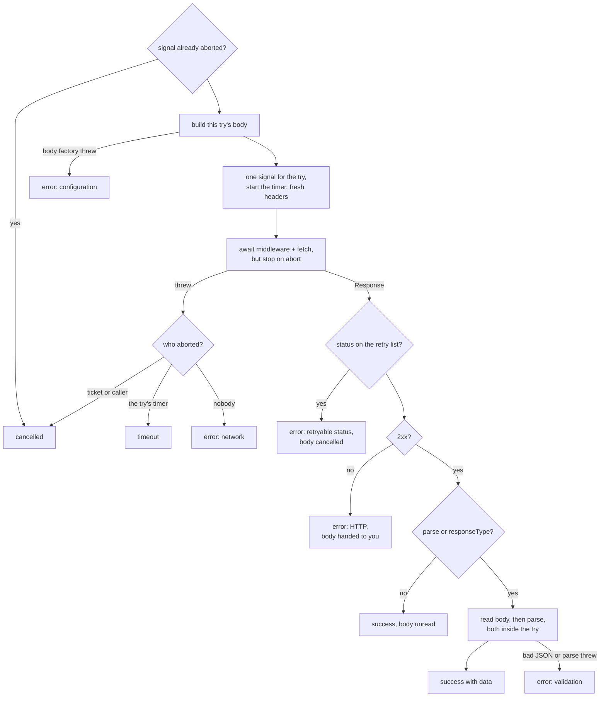

# 6. One attempt

> **Crux:** How does one attempt turn a `fetch` into exactly one of four outcomes, and how is it guaranteed to end?

In chapter 5, each try of our `GET /users/42` was a closed box. Something went in, and one of
four outcomes came out: **success**, **error**, **timeout** or **cancelled**. The first attempt
and every retry use the same box, a function called `executeRequest` in
`src/queue/executor.ts`. This chapter opens it.

The function has two jobs. The first is to **classify**: a 503 is worth another try, a 404 is
not, a body that isn't JSON is the server's mistake, and a dropped connection is the network's.
The second job is harder than it looks: to **end**. Whatever the transport, your middleware or
your parse function does, the attempt must return when its timer fires or its ticket is
cancelled. If it doesn't, the ticket never settles, the slot it holds is never freed, and the
per-attempt timeout is a promise the library can't keep.

## Our three attempts

The running example sends all three of the interesting kinds of attempt:

| Try | Fake server | Outcome | What decided it |
| --- | --- | --- | --- |
| 1 | hangs until aborted | timeout | the attempt's own timer fired at 200 ms |
| 2 | answers 503 | error (retryable status) | 503 is on the retry list |
| 3 | answers 200 with JSON | success | the body read and parsed in time |

We'll walk through the function in the order its code runs, and stop wherever one of these
three takes a turn.

## The shape of the function

The function takes everything one try needs: the URL, the request's options, the merged timeout
and retry settings, the ticket's signal, the try number and a few more. It also takes the
client's middleware list. It returns one of four kinds:

`src/queue/executor.ts` — `ExecuteResult`
```typescript
export type ExecuteResult =
	| { kind: "success"; result: Extract<Result<unknown>, { success: true }> }
	| { kind: "timeout" }
	| { kind: "cancelled" }
	| { kind: "error"; error: AppError };
```

It never throws. Every path through it returns one of these four, and it never touches the
ticket's state. Deciding what an outcome means for the ticket is the caller's job (chapters 5
and 7).



*What to notice: the status is checked before the body is read, so a 503 never pays for reading
a body. Try 1 leaves through "timeout", try 2 through "retryable status", and try 3 through
"success with data".*

## Before sending

Two quick things happen first. If the ticket or your own signal has already fired, the try
returns "cancelled" without doing anything. Then, if the request's body is a function rather
than a value, it's called now, once per try, so every retry sends a fresh body. If that function
throws, the try ends as an error with a `ConfigurationError`. Chapter 9 explains why the circuit
breaker ignores that error: the request never left the process.

Our request is a GET with no body, so neither applies.

### One signal for the try

Three things can end a try: the ticket's signal (a cancel or the overall deadline), the signal
you passed in, and the try's own timer. The function combines them into one:

`src/queue/executor.ts` — `executeRequest`
```typescript
const sources: AbortSignal[] = [signal];
if (options.signal) sources.push(options.signal);
const hasAttemptTimeout = isBoundedMs(timeoutMs);
// Always created (not just when attemptMs is bounded): a handed-off
// Response's body read may still need bounding by `deadlineAt` alone in
// `finally` below, even when this attempt itself has no attemptMs cap.
const timeoutController = new AbortController();
sources.push(timeoutController.signal);
const attemptSignal = AbortSignal.any(sources);
const timeoutId = hasAttemptTimeout ? setTimeout(() => timeoutController.abort(), timeoutMs) : undefined;
timeoutId?.unref?.();
```

The combined signal is what middleware and `fetch` see. For our request, the timer is set for
200 ms.

Remember the timer's controller. It's the try's *own* record of whether its timer fired, and
every decision below asks it, never the error that came back. Note also the `unref`: the timer
won't keep Node alive on its own. That's why the running example needs its `setInterval`.

> **Aside: why not one listener per source.** Combining signals with `AbortSignal.any` attaches
> no listener to the sources. A caller who reuses one signal for thousands of requests would
> otherwise collect one listener per try (#7).

### The middleware chain

Each try gets a fresh context: the URL, the method, a new copy of the headers, the body, the
combined signal, the try number, the ticket's id and the partition. A fresh copy of the headers
means a middleware that adds one can't leak it into the next retry. Then the middleware is
wrapped around the real `fetch` call:

`src/queue/executor.ts` — `composeMiddleware`
```typescript
export function composeMiddleware(middlewares: MiddlewareFn[], core: NextFn): NextFn {
	return middlewares.reduceRight<NextFn>((next, middleware) => (ctx) => middleware(ctx, next), core);
}
```

This builds an onion. Starting from the innermost layer, the `fetch` call, it wraps each
middleware around the last, from the last one registered to the first. So the **first**
middleware you register is the **outermost**: it runs first on the way in and last on the way
out. The last one registered runs closest to `fetch`. That's why the tracing middleware in
`src/otel/index.ts` asks to be registered last: it wants to time the request itself.

The running example registers no middleware, so the onion is just `fetch`.

## Waiting for a response, but not forever

> **See it run:** the [timeout simulator](https://vereda.dev/patterns/timeouts/) plays this with and without the pattern.

Try 1 sends its request at 20 ms, and the fake server never answers. Here is the line that
waits:

`src/queue/executor.ts` — `executeRequest`
```typescript
const pending = composed(ctx);
response = await settleOnAbort(pending, attemptSignal, () => {
	void discard(pending);
});
```

You might expect a plain `await composed(ctx)`. That works only if the transport stops when its
signal fires. The real `fetch` does, and so does our fake server. But a custom `fetch` that
ignores its signal, or a middleware that swaps the signal out, doesn't, and a plain `await`
would then wait as long as the transport does: past the per-attempt timeout, past the overall
deadline, past `cancel()`.

So the wait is a race between the response and the signal:

`src/queue/executor.ts` — `settleOnAbort`
```typescript
function settleOnAbort<T>(
	pending: Promise<T>,
	signal: AbortSignal,
	release: () => void = () => {
		pending.catch(() => {});
	},
): Promise<T> {
	if (signal.aborted) {
		release();
		return Promise.reject(signal.reason);
	}
	return new Promise((resolve, reject) => {
		const onAbort = () => {
			release();
			reject(signal.reason);
		};
		signal.addEventListener("abort", onAbort, { once: true });
		pending.then(
			(value) => {
				signal.removeEventListener("abort", onAbort);
				resolve(value);
			},
			(err: unknown) => {
				signal.removeEventListener("abort", onAbort);
				reject(err);
			},
		);
	});
}
```

Whichever comes first wins. If the signal fires first, the try moves on, and the `release`
callback deals with the abandoned promise: it waits for a late response and cancels its body, so
the connection is freed, and it swallows a late rejection so it doesn't become an unhandled one.
The abandoned request may still be on the wire; Vereda just stops waiting for it.

> **Aside: the bug that added this race (#181).** Before it, a custom `fetch` that ignored its
> signal made `cancel()`, `attemptMs` and `totalMs` all ineffective: the ticket resolved, but the
> attempt never returned, so the client's terminal event never fired. Freeing a late response's
> body is B13.

### Who aborted?

At 200 ms, try 1's timer fires. The combined signal aborts, the race rejects, and the code lands
in the catch block, which decides what kind of ending this was:

`src/queue/executor.ts` — `executeRequest` (catch)
```typescript
} catch (err) {
	if (signal.aborted || options.signal?.aborted) {
		return { kind: "cancelled" };
	}
	if (timeoutController.signal.aborted) {
		return { kind: "timeout" };
	}
	return {
		kind: "error",
		error: new NetworkError(err instanceof Error ? err.message : "Network error", { cause: err }),
	};
}
```

Neither the ticket nor any signal of yours has fired, but the timer's controller has, so try 1
returns **timeout**. Two rules live in these lines:

- **A cancel beats a timeout.** If both fired, report "cancelled". Your intent is final.
- **Ask which signal fired, not what the error looks like.** A middleware that wraps and rethrows
  an abort error changes its name and type. The timer's controller can't be fooled that way.

Anything else that throws, such as a DNS failure, a refused connection or a reset socket, is a
`NetworkError`, which the default policy retries.

The same two checks run once more just after a response arrives, because an abort can land
between `fetch` resolving and the next line, for example while a middleware post-processes the
response. Then the body is cancelled before returning.

## Classifying the status

Try 2 gets a response: a 503. Before reading any body, the function checks the status:

`src/queue/executor.ts` — `executeRequest`
```typescript
if (retryOnStatus.includes(response.status)) {
	response.body?.cancel().catch(() => {});
	return {
		kind: "error",
		error: new RetryableStatusError(
			`HTTP ${response.status} ${response.statusText}`,
			response.status,
			response,
			parseRetryAfter(response.headers.get("retry-after")),
		),
	};
}

if (!response.ok) {
	handedOff = true;
	return {
		kind: "error",
		error: new HttpError(`HTTP ${response.status} ${response.statusText}`, response.status, response),
	};
}
```

A status on the retry list (by default 408, 425, 429, 500, 502, 503 and 504) becomes a
retryable-status error, and its body is cancelled: nobody reads the body of a try that's about to
be repeated. If the response had a `Retry-After` header, it's turned into milliseconds here, for
chapter 7. Our 503 has none, so try 2 returns an **error**, and the retry loop goes round again.

Any other status outside 2xx becomes an `HttpError`, which the default policy never retries. Its
body is **handed off**: you can read it later from the error, for example to log the message the
server sent. Handing off a body has a consequence that the last section of this chapter deals
with.

## Reading the body, inside the attempt

Try 3 gets a 200. Our request passed a parse function, so the body is read now, while the try's
timer is still running. That's the point: a slow body or a slow parse is part of the try, and
counts against the same 200 ms.

The body isn't read with `response.json()`. The built-in readers lock the stream, so cancelling
the body can't interrupt them, and with a transport that ignores its signal they could read
forever. Instead, the library takes its own reader and cancels it when the signal fires:

`src/queue/executor.ts` — `readBytes`
```typescript
const reader = response.body.getReader();
const onAbort = () => {
	reader.cancel(signal.reason).catch(() => {});
};
if (signal.aborted) onAbort();
else signal.addEventListener("abort", onAbort, { once: true });
try {
	// ... read chunks until done
	// A cancelled reader reports `done` rather than rejecting.
	if (signal.aborted) throw signal.reason;
	// ... concatenate and return
} finally {
	signal.removeEventListener("abort", onAbort);
}
```

The bytes are then decoded as the request asked: as JSON by default when there's a parse
function. Malformed or empty JSON becomes a `ValidationError`. The server answered, and asking
again would get the same bad body, so it's never retried. Any *other* failure while reading,
such as the stream dying halfway, is a real network error.

Then the parse function runs, inside the same race as `fetch`, so a parse that never settles ends
as a timeout, and `cancel()` ends it too. A parse that throws becomes a validation error, with
the schema library's list of issues copied onto it when there is one.

Our body is `{"id":42,"name":"Ada"}`. The parse function, `json<User>()`, just passes it
through, so try 3 returns **success** with that data, and the retry loop settles the ticket.

> **Aside: history, and two orders.** Bounding the parse inside the attempt is #142. Treating bad JSON as a validation error is B6 (#88): before it, a non-JSON body
> counted as a network error and was retried four times. In the read and parse catch blocks, the
> timer is checked *before* cancellation, the opposite of the main catch block. The comments
> explain each choice but not the difference. In practice the result is the same, because a
> cancelled ticket is already settled by `cancel()`. What can differ is the circuit breaker: it
> counts a timeout as a failure, and ignores a cancel.

## Handing off an unread body

If a request has no parse function and no response type, a successful try returns at once, with
the body unread on the result's raw response. The same happens to the body of an `HttpError`.
That raises a question: if you read that body ten minutes later, and the server sends it slowly,
what stops the read from hanging?

The answer is in the function's `finally` block:

`src/queue/executor.ts` — `executeRequest` (finally, abridged)
```typescript
} finally {
	if (timeoutId !== undefined) clearTimeout(timeoutId);

	if (handedOff) {
		// ... boundAt = min(attemptStart + attemptMs, deadlineAt)
		if (Number.isFinite(boundAt)) {
			const delay = Math.max(0, boundAt - Date.now());
			const reason = /* TimeoutError or DeadlineExceededError, whichever bound is sooner */;
			const bodyReadTimer = setTimeout(() => {
				timeoutController.abort(reason);
			}, delay);
			bodyReadTimer.unref?.();
		}
	}
}
```

For a handed-off body, the try sets a new timer for whichever comes sooner: the end of its own
per-attempt window, counted from when the try started, or the ticket's overall deadline. When the
timer fires it aborts the try's signal, which `fetch` is still using for the body stream. A late
read then fails with Vereda's own `TimeoutError` or `DeadlineExceededError`, not a bare browser
exception. The ticket isn't touched; it settled long ago.

This is how the README's promise is kept: "the body read has to finish within the same
`attemptMs` (counted from when the attempt started)".

> **Aside: history.** The read deadline for handed-off bodies is #96; naming the error after the
> bound that fired is #98.

## Design note: classify by signal, not by error

Before #122, the attempt decided "was this a timeout?" by checking whether the thrown error was
named `AbortError`. The fix replaced that with "did our timer's controller fire?", for the reason
in the catch block's comment: "middleware may wrap/rethrow the abort error (losing its
`AbortError` name), and the attempt's own timeout controller is the authority on whether the
attempt timed out."

The same idea, trust your own signals over what comes back from code you don't control, later
led to the race around `fetch` and to the library owning its body reader. The lesson to take
away: **an attempt ends because Vereda's signals say so, never because the transport
cooperated.**

## What must stay true

- The attempt function never throws and never changes the ticket's state. It returns one of four
  kinds.
- Every wait in a try (middleware and `fetch`, the body read, the parse) is bounded by the try's
  signal, whether or not the code it waits on honours signals.
- In the main catch path, a cancel is checked before a timeout, and a timeout is recognised by
  the timer's controller, never by the error's shape.
- A body nobody will read (a retryable status, an aborted try) is cancelled. A handed-off body
  gets a read deadline.
- Malformed JSON and a failing parse are validation errors and never retried. A body stream that
  dies halfway is a network error.
- Each try gets fresh headers and, from a body function, a fresh body.

## Try it

Use a client with a fake `fetch` in a scratch file, as in the running example, with its
`setInterval` keep-alive.

1. **Predict the onion.** Register middleware A, then B, each logging before and after
   `await next(ctx)`; A also logs `ctx.attempt`. The fake `fetch` logs `fetch`. What's printed
   for one successful request? (`A before (attempt 0) | B before | fetch | B after | A after`.)
2. **Predict, then run.** A `fetch` that always returns `new Response("<html>")`, with
   `parse: (d) => d`. How many fetches, and what's the error? (One fetch; `validation`, with the
   message `Response body is not valid JSON`.) Now use `responseType: "text"` and a parse that
   throws. (One fetch; `validation`, `Response validation failed`.)
3. **Predict, then run.** Replace the running example's server with one that ignores its signal:
   `() => new Promise(() => {})`, with `timeout: { attemptMs: 50 }` and `retry: { maxRetries: 0 }`.
   Does the ticket settle? (Yes, with kind `timeout`, after about 50 ms.) Find the function that
   makes this possible, then read `test/queue/signal-deaf-fetch.test.ts`.
4. **Predict, then run.** `attemptMs: 50`, no parse, and a `fetch` whose body stream sends
   `"partial"` and never closes (but errors when its signal aborts). The ticket succeeds. What
   happens when you `await result.raw.text()`? (It rejects once the try's 50 ms are up, with a
   `TimeoutError` whose message is `Request to http://x.test/ timed out after 50ms`.)
5. **Change + test.** Write middleware that adds an `X-Attempt` header with the try number, and a
   test that a server sees `0` then `1` when the first try returns 503. Copy the server setup
   from `test/core/client.integration.test.ts`.
