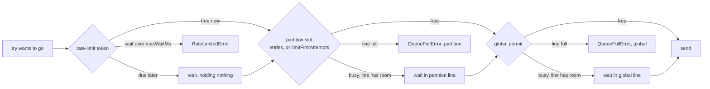

# 8. Isolation: bulkheads, the global cap and the rate limiter

> **Crux:** How does Vereda keep one bad host from eating everyone else's capacity?

A service talks to many hosts. When one of them gets slow or starts failing, two things go
wrong unless something stops them.

Retries to the bad host pile up and take every connection the process has, so requests to healthy
hosts wait behind them. And the bad host, already struggling, gets more traffic than ever, right
when it can least handle it.

Vereda has three mechanisms against this, all in `src/queue/`:

- a **global cap**: a limit on tries in flight across the whole client;
- a **partition bulkhead** per host: a limit on *retries* in flight to that host, with a bounded
  waiting line;
- an optional **rate limiter** per host: a limit on how many tries *start* each second.

The name "bulkhead" comes from ships. A hull is split into watertight compartments, so a breach
in one doesn't sink the whole ship. Here each host, each **partition** in Vereda's words, is a
compartment.

Our running example passed all of these without waiting, so in chapter 5 they were invisible.
This chapter makes them visible: what each try of `GET /users/42` had to take before it could
go, and what would have happened on a busier day.

## What our request took

The client has a public way to look inside the compartments: `client.partitions()` returns a
snapshot of each partition's bulkhead. If the fake server in the running example prints that
snapshot each time it's called, and a timer prints it every 100 ms in between, you get this:

```text
   27  fetch #1   api.example.com  running 0, queued 0
  105  (waiting)  api.example.com  running 0, queued 0
  208  (waiting)  api.example.com  running 0, queued 0
  210  event retry 0
  262  fetch #2   api.example.com  running 1, queued 0
  264  event retry 1
  281  fetch #3   api.example.com  running 1, queued 0
  283  event success
```

Two things stand out.

**Fetch #1 doesn't count as running in its partition.** The first try of a request doesn't use
the partition bulkhead at all; it takes only a permit from the global cap. Chapter 5's design
note explained why: new traffic to a healthy host shouldn't wait behind someone else's retries.

**Each retry counts while it's being sent, and only then.** Fetches #2 and #3 each hold one of
the partition's five slots. Between them, while the request sleeps through its backoff, the
count is back to zero. A request that is only waiting holds nothing.

The rest of the chapter explains the machinery behind those two lines.

## The order things are taken in

Every try may need up to three things before it goes out: a rate-limit token, a partition slot
and a global permit. It takes them in this order:



*What to notice: each thing is taken only after the one before it is secured, and the token
comes first. A try that is waiting for its turn never holds something another try could use.*

A first try skips the middle step, unless its partition sets `limitFirstAttempts`. When the try
ends, it gives things back in reverse: the global permit first, then the partition slot.

The code comments give the reason for each position. The token comes first "so an attempt
waiting for its token never holds concurrency another one could use", and the global permit is
"acquired after the partition slot and released before it".

> **Aside: decision labels.** Comments throughout the code cite labels like D1 (the global cap),
> D3 (the retry policy), D4 (this ordering) and R6 (`limitFirstAttempts`). No file in the repo
> defines them. What they decided survives only in the comments that cite them.

## The global cap

The global cap is a **semaphore**: a counter of free permits plus a line of callers waiting for
one. It lives in `src/queue/semaphore.ts`, and its main method is short:

`src/queue/semaphore.ts` — `acquire`
```typescript
acquire(signal?: AbortSignal): Promise<() => void> {
	if (signal?.aborted) {
		return Promise.reject(new CancelledError());
	}

	if (this.available > 0) {
		this.available--;
		return Promise.resolve(this.releaseOnce());
	}

	if (this.waitQueue.length >= this.maxQueueSize) {
		return Promise.reject(new QueueFullError("global", this.waitQueue.length, this.maxQueueSize, "global"));
	}

	return new Promise<() => void>((resolve, reject) => {
		const onAbort = () => {
			const idx = this.waitQueue.indexOf(grant);
			if (idx !== -1) this.waitQueue.splice(idx, 1);
			reject(new CancelledError());
		};
		const grant = () => {
			signal?.removeEventListener("abort", onAbort);
			this.available--;
			resolve(this.releaseOnce());
		};
		signal?.addEventListener("abort", onAbort, { once: true });
		this.waitQueue.push(grant);
	});
}
```

Read the three outcomes in order: a permit is free, so take it; the line is full, so fail; or
join the line. Three details matter.

**A full line fails at once.** Vereda prefers telling the caller "too busy" right away over
letting a line grow without limit. The error is a `queue_full` whose `scope` says which line
was full, here `"global"`. With the client's line size set to 0, there is no waiting at all: if
no permit is free, the request fails.

**A waiter whose request is cancelled leaves the line.** The abort listener takes it out and
rejects with a cancel. Otherwise dead requests would hold places in line, and live ones would be
turned away from a line that was only full of ghosts.

**Giving a permit back twice does nothing.** The release function guards itself (that's
`releaseOnce`), so code that releases on two paths can't create a permit out of nothing.

The defaults are 50 permits and a line of 100. Every try takes a permit, first tries included.

The global cap is the one place where one host's trouble can still reach another: a host that hangs
holds its permits for up to `attemptMs` each. Our running example held one for 200 ms while fetch #1
hung. The README's "one failing dependency" section and the [operations guide](../operations.md)
("Sizing concurrency and queues") cover how to size it.

> **Aside: two fixes here.** Leaving the line on cancel is bug B9, fixed in #88. The `scope`
> field is newer: before it, a full global line was reported as "partition `global`", which a
> partition really named `global` would also match. Checking `partition === "global"` still
> works in 1.x but is deprecated; 2.0 drops the partition name from a global `queue_full`.

## The partition bulkhead

> **See it run:** the [bulkhead simulator](https://vereda.dev/patterns/bulkhead/) plays this with and without the pattern.

The partition bulkhead in `src/queue/bulkhead.ts` is a second semaphore with a name, a count of
running tries, its own waiting line and, optionally, a token bucket. Its main method, `run`,
takes a slot, then a global permit, then runs the try:

`src/queue/bulkhead.ts` — `Bulkhead` — `run` (abridged)
```typescript
run<T>(task: () => Promise<T>, semaphore?: Semaphore, onDequeue?: (queuedMs: number) => void, signal?: AbortSignal): Promise<T> {
	const enqueuedAt = Date.now();
	return new Promise<T>((resolve, reject) => {
		if (signal?.aborted) {
			reject(new CancelledError());
			return;
		}
		const onAbort = () => { /* remove `execute` from the line, reject with a cancel */ };

		const execute = () => {
			signal?.removeEventListener("abort", onAbort);
			this.running++;
			const runTask = (release?: () => void) => {
				onDequeue?.(Date.now() - enqueuedAt);
				return task().then(
					(result) => { release?.(); this._releaseSlot(); resolve(result); },
					(err) => { release?.(); this._releaseSlot(); reject(err); },
				);
			};
			if (semaphore) {
				semaphore.acquire(signal).then(
					(release) => { void runTask(release); },
					(err) => {
						onDequeue?.(Date.now() - enqueuedAt);
						this._releaseSlot();
						reject(err);
					},
				);
			} else {
				void runTask();
			}
		};

		if (this.running < this.concurrency) {
			execute();
		} else if (this._waitQueue.length < this.maxQueueSize) {
			signal?.addEventListener("abort", onAbort, { once: true });
			this._waitQueue.push(execute);
		} else {
			reject(new QueueFullError(this.name, this._waitQueue.length, this.maxQueueSize));
		}
	});
}
```

Start at the bottom, where the same three outcomes appear: run now, wait in line, or fail. Then
read `execute`, which is what runs when the slot is granted. It counts the slot, gets the global
permit *while holding the slot*, runs the try, and gives both back.

Fetch #2 of our request went through exactly this path. The partition had five free slots, so
`execute` ran at once; the global cap had a free permit; the try ran; and when the 503 came back
both were returned, which is why the next snapshot showed zero running.

Two orderings in this function were bugs once.

**The permit is given back before the slot.** Giving back the slot immediately starts the next
waiter in line, and that waiter's first move is to ask the global cap for a permit.

If this try still held its permit at that moment, the waiter could find none free and be refused,
even though one was about to come back. The comment inside `execute` explains this.

**A refused permit gives back the slot.** If the slot was granted but the global cap then says no
(its line is full, or the request was cancelled while waiting), the slot must be returned.
Otherwise it stays counted as running forever, a "phantom" slot that shrinks the partition's
capacity by one for good.

Every path that lowers the running count goes through one helper, `_releaseSlot`, which also
starts the next waiter.

The `onDequeue` callback reports how long the try waited for its slot and permit together. The
retry loop adds that to the ticket's `queuedMs`.

> **Aside: where the orderings came from.** The release-order race was fixed in #79. Giving
> each retry its own slot, instead of holding one slot for the ticket's whole retry loop, is
> #38 (chapter 5).

### Defaults and configuration

Each partition bulkhead has 5 slots and a line of 100 by default, configured per host through
`partitions[name]` or for every other host through `defaultPartition`. A partition's line must
hold at least 1, while the global line may be 0. The two validators in `src/core/validate.ts`
check them by different rules, and the code doesn't say why.

A full partition line fails with `queue_full` and `scope: "partition"`. That is a retry, or a
first attempt too when the partition sets `limitFirstAttempts` (#220 fixed the error's docs,
which said only retries).

## The rate limiter

> **See it run:** the [rate limiter simulator](https://vereda.dev/patterns/rate-limiter/) plays this with and without the pattern.

A bulkhead limits how many tries run *at once*. A rate limit limits how many *start each
second*, which is what an API quota ("100 requests per second") actually measures. It's opt-in:
`rateLimit: { tokensPerSec, burst?, maxWaitMs? }`, set on the client (which gives each partition
its own limit) or on a partition.

The limit is a **token bucket**: a bucket that fills at a steady rate, from which every try
takes one token. Vereda's, in `src/queue/rate-limiter.ts`, uses a reservation model:

`src/queue/rate-limiter.ts` — `TokenBucket` — `reserve`
```typescript
reserve(now: number = Date.now(), at: number = now): number | null {
	const waitMs = this.waitFrom(now, at);
	if (this.maxWaitMs !== undefined && waitMs > this.maxWaitMs) return null;
	this.tokens -= 1;
	return waitMs;
}
```

The balance is allowed to go below zero. A caller who arrives at an empty bucket takes a token
anyway and is told exactly how long until that token would have existed.

The next caller sees an even lower balance and is told to wait longer. So callers are served in the
order they arrived, at exactly the configured rate, without the bucket keeping a line of waiters.
The class comment credits Go's `x/time/rate`, which works the same way.

(`waitFrom` does the sum: the time until the bucket may refill, plus the time to earn back a
deficit. The optional `at` argument lets a caller reserve as of a later moment; that is how a pause
uses the bucket, below.)

### Our request, rate-limited

Give the running example `rateLimit: { tokensPerSec: 2, burst: 1 }`, and make backoff
predictable with `{ baseDelayMs: 1, jitter: false }`. Two tokens a second means one every 500 ms.

```text
   16  fetch #1              took the only token; hangs
  204  event retry 0         wait 1 ms
  503  fetch #2  → 503       waited ~300 ms for a token
  505  event retry 1         wait 2 ms
 1003  fetch #3  → 200       waited ~500 ms for a token
 1005  event success         attempts 3, queuedMs 794
```

Follow the bucket. Fetch #1 took the one token at the start. When the retry's 1 ms backoff
ended, about 200 ms had passed, so the bucket had refilled 0.4 of a token; a whole one was due
300 ms later, and fetch #2 went out at about 500 ms.

The second retry found the bucket empty again and waited about 500 ms more. Notice that the `retry`
events still report the backoff (1 ms, 2 ms). The token waits are counted separately, in the success
event's `queuedMs`: about 300 + 500 ms.

On the request path, the bulkhead's `takeToken` wraps the bucket. It has three answers. "Go
now" when a token was free. A promise to wait on when the token is due later; if the request is
cancelled meanwhile, the token goes back in the bucket and the wait ends with a cancel.

The third answer is a `RateLimitedError`, thrown when the wait would be longer than `maxWaitMs`.
That error is never retried: the limit is your own setting, and the next wait would only be longer.

When `pauseOnRetryAfter` is configured, the same method also waits out a pause (next section),
and the wait it checks against `maxWaitMs` includes it.

`burst` is the bucket's size: how many tries may go back to back after a quiet spell. It
defaults to one second's worth, but never less than 1, because a bucket that can't hold a whole
token could never hand one out.

### Pausing a host that said "later"

A rate limit is your guess at the host's quota. A `Retry-After` is the host telling you.

The opt-in `pauseOnRetryAfter: { statuses?, maxPauseMs? }` (client or partition level) turns the
second into a rule for the whole partition: when an attempt fails with a 429 or 503 (the
defaults) that carries a positive `Retry-After`, nothing else goes to that partition before the
time it names.

The header is clamped to `maxPauseMs`, 30 s by default, so a hostile or buggy
value can't park a partition for hours. A status has to be in `retry.retryOnStatus` to be seen.

The state is one small class, in `src/queue/pause.ts`:

`src/queue/pause.ts` — `PartitionPause` — `extend`
```typescript
extend(ms: number, now: number = Date.now()): number {
	this._until = Math.max(this._until, now + Math.min(ms, this.maxPauseMs));
	return this._until;
}
```

It takes the later of the old end and the new one, so a short `Retry-After` never ends a pause
early. Each `Bulkhead` owns one `PartitionPause` (when configured), and three methods use it:

- `notePushback` reads a failed attempt's error. If it is a listed status with a positive
  `retryAfterMs`, it extends the pause and calls `freezeUntil` on the bucket, if there is one.
  `freezeUntil` drains the bucket to zero tokens and holds the refill point at the pause's end,
  so traffic resumes at `tokensPerSec` instead of in a burst.
- `guard` wraps an attempt. It calls `notePushback` the moment the attempt settles, before the
  slot is released and the next queued attempt starts. And if the attempt reaches the front of a
  line during a pause, it sends nothing and resolves with a marker, `PAUSED`.
- `takeToken` waits out the pause before every attempt, with the token reserved as of the
  pause's end. A pause extended while it waits makes it wait again, keeping its token.

An attempt that comes back `PAUSED` was never sent. The first attempt and the retry loop both
loop on it, going back to `takeToken`, and the wait counts as queue time, not as an attempt.

Pausing is a cost to the caller too, so two checks fail early. A first attempt (and a retry)
whose pause outlasts `totalMs` fails at once with `DeadlineExceededError`. A retry that the pause
would hold past `maxWaitMs` fails with `RateLimitedError`, whose `pausedUntil` says when the
pause ends. `client.partitions()` shows the same time as `pausedUntil` while a pause is active.

### Turning the limit off for one host

A client-wide rate limit applies to every partition. Sometimes one host shouldn't have it, an
internal service with no quota, say. A partition can set `rateLimit: false`, and when its
bulkhead is built, the client's limit is dropped instead of merged:

`src/queue/bulkhead.ts` — `mergeOptional`
```typescript
export function mergeOptional<T extends object>(
	global: T | false | undefined,
	partition: T | false | undefined,
): T | undefined {
	if (partition === false || global === false) return undefined;
	if (!global && !partition) return undefined;
	return { ...global, ...partition } as T;
}
```

The `false` checks are the trap: copying the fields of `false` into an object adds nothing, so a
naive merge would quietly keep the client's limit. The same function merges `pauseOnRetryAfter` and
`retryBudget`. Any value other than an object or `false` is rejected when the client is created. The
retry budget, in the next chapter, has the same switch.

> **Aside: history.** The rate limiter arrived in #145. The per-partition off switch is #190.

## Registries and eviction

Partitions are created on demand. The first request to `api.example.com` creates its bulkhead,
in the bulkhead registry's `get`. That registry extends `PartitionRegistry`
(`src/queue/partition-registry.ts`), which the breaker and retry budget registries extend too.

`PartitionRegistry` remembers when each entry was last used. Every tenth `get()` (or whenever it
holds more than 100 entries) it **prunes**: it deletes entries that are idle and unused for 60
seconds. Without this, a client that calls many different hosts would grow its map forever.

The danger is evicting a bulkhead that's still in use. The next `get()` would build a fresh one,
and for a while two bulkheads would exist for the same host, doubling its limit. So "idle" has
a careful definition:

`src/queue/bulkhead.ts` — `isEvictable`
```typescript
isEvictable(now: number): boolean {
	return (
		this.activeTickets === 0 &&
		this.running === 0 &&
		this._waitQueue.length === 0 &&
		// A drained bucket must outlive its tickets: a fresh one starts full
		// and would let a burst through that the rate limit forbids.
		(this.bucket === undefined || this.bucket.isFull(now)) &&
		// A pause must outlive its tickets too: a fresh bulkhead would send
		// straight into the host that just said to wait.
		(this.pause?.remaining(now) ?? 0) === 0
	);
}
```

Nothing running and nothing waiting isn't enough. Look back at our request's snapshots: between
fetches, while it slept through its backoff, the partition showed nothing running and nothing
queued. Yet our request was coming back.

The first condition covers this: chapter 5's "hold" on the partition objects, taken once per
request and released by its cleanup.

A rate-limited bucket that's been drained must survive until it refills, or eviction would hand out
a fresh, full one. A paused partition's bulkhead survives until the pause ends, for the same reason:
a fresh one would send straight into the host that said to wait.

The circuit breaker and retry budget (chapter 9) answer the same `isEvictable(now)` question,
each with its own rule for when an entry may go.

> **Aside: bug B12.** Evicting a busy bulkhead, and so doubling a host's limit, really happened.
> The holds are the fix. Issue #192 then moved the sweep and eviction of all three registries
> into one generic class.

## Watching it

`client.partitions()` returns one snapshot per live partition: `partition` (its name),
`running`, `queued`, `concurrency`, `maxQueueSize`, `tokens` when the partition is
rate-limited, and `pausedUntil` (epoch ms) while a `Retry-After` pause is active.

The metrics sink also gets a queue-depth gauge per partition and one for the global line. Chapter 10
covers when those are sampled.

> **Aside: `name` vs `partition`.** Snapshots used to name the partition in a field called
> `name`, while circuit snapshots called it `partition`. Both fields exist in 1.x, with the same
> value; `name` is deprecated and goes away in 2.0.

## Design note: why only retries use the bulkhead

You met this choice in chapter 5. Here is what it means for this chapter's machinery. The
partition bulkhead has a narrow job: to limit the *retry pressure* any one host can create.
That's why fetch #1 showed zero running.

Fresh requests go straight to the global cap, so a healthy host's new traffic never waits behind a
sick host's retries, and a sick host's first tries still go out, which is how you find out it has
recovered.

The cost is that a host which fails *slowly* can tie up global permits with first tries, as
fetch #1 did for 200 ms. The README documents this, and `limitFirstAttempts` lets a partition
send its fresh traffic through the bulkhead too, trading some latency for a firmer wall.

## What must stay true

- Every try takes a token (if rate-limited), then a partition slot (retries, or every try with
  `limitFirstAttempts`), then a global permit, and gives the permit back before the slot.
- Nothing is held during backoff.
- Every line is bounded. A full line fails at once with `queue_full`, and its `scope` says
  which line.
- A waiter whose request is cancelled leaves its line; a cancelled token wait returns its token.
- Every path that lowers the running count goes through `_releaseSlot`.
- A bulkhead is never evicted while a request holds it, while anything runs or waits in it, or
  while its bucket is below full.
- A partition's `rateLimit: false` drops the client's limit for that partition. The same goes for
  `pauseOnRetryAfter: false` and `retryBudget: false`, through `mergeOptional`.
- A pause only moves forward, and an attempt bounced by one is not counted as an attempt.
- A paused bulkhead is not evicted until the pause ends.

## Try it

1. **Predict, then run.** A partition with `concurrency: 1, maxQueueSize: 1`. Three GETs to
   different paths on that host; each path's first try returns 503, and every retry takes
   200 ms and returns 200. Backoff is `{ baseDelayMs: 1, jitter: false }`. What does
   `client.partitions()` show 50 ms in, and what are the three results? (`running: 1, queued: 1`;
   results ok, ok, `queue_full`. The third retry finds the slot busy and the line full.)
2. **Predict, then run.** `concurrency: 1, maxQueueSize: 0` at client level, `maxRetries: 0`,
   and a `fetch` that takes 50 ms. Fire two requests to *different* hosts at once. (The first
   succeeds; the second is `queue_full` with `scope: "global"` and the message
   `Global queue is full (0/0)`. Different hosts don't help with the global cap.)
3. **Compute, then check.** `new TokenBucket({ tokensPerSec: 2, burst: 1 }, 0)`: what do three
   calls to `reserve(0)` return? Then `available(0)`? (`0`, `500`, `1000`, then `0`.) With
   `maxWaitMs: 600`, what does the third `reserve(0)` return? (`null`.)
4. **Predict, then run.** `rateLimit: { tokensPerSec: 10, burst: 2 }`, four simultaneous GETs to
   one host, and a `fetch` that records the time since the start. Roughly when does each try go
   out? (About 0, 0, 100 and 200 ms.) Then add `partitions: { "<that host>": { rateLimit: false } }`
   and run again. (All four at about 0 ms.)
6. **Predict, then run.** `pauseOnRetryAfter: {}` and a server that answers the first request
   with `503` and `Retry-After: 1`, then `200`. A second GET to the same host starts 100 ms
   after the first. When does its first try reach the server? (About 1,000 ms after the first
   one failed, not at 100 ms: the pause covers the whole partition. Check `client.partitions()`
   for `pausedUntil` meanwhile.)
5. **Read a test.** `test/queue/prune-held-reference.test.ts` checks that a request in retry
   backoff keeps its bulkhead past the 60-second idle limit. How does it get past 60 seconds
   without waiting 60 seconds? (It calls `vi.useFakeTimers()` and then
   `vi.advanceTimersByTimeAsync(DEFAULT_PARTITION_TTL_MS + 1_000)`. Vitest's fake timers also
   fake `Date.now()`, which the registries use for last-use times. Reuse this pattern for any
   test that involves the idle limit, backoff or rate-limit waits.)
