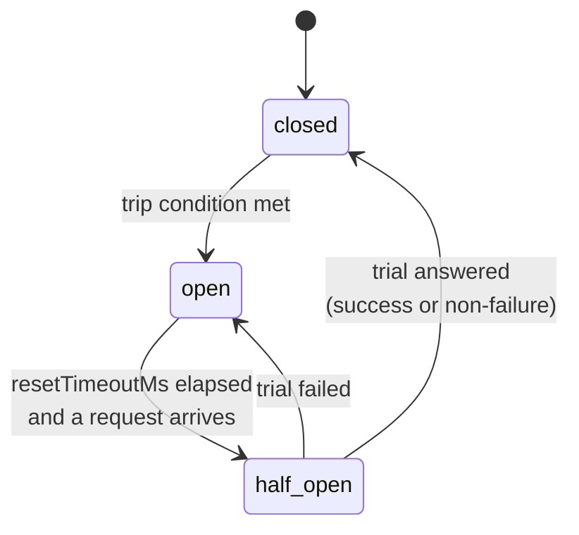

# 9. Failing fast: the circuit breaker and the retry budget

> **Crux:** How does Vereda decide to stop calling a host, or stop retrying it?

Chapter 8's mechanisms make requests *wait*. This chapter's two mechanisms make them *fail*, on
purpose, without sending anything. That sounds backwards, but it's the right call when a host is
in trouble. Every request sent to a host that's down costs the caller a timeout and costs the
host load it can't handle. Failing fast gives both of them a break.

- The **circuit breaker** watches each partition's results. After enough failures it *opens* and
  refuses every try, then lets one trial through after a pause.
- The **retry budget** caps each partition's retries to a fraction of its recent traffic, so a
  wave of retries can't multiply the load on a struggling host.

Both are off unless you turn them on, and both work per partition. In chapter 5, the breaker was
the gate before the first try and the second gate of every retry round; the budget was the
sixth gate. Our running example had neither, so it sailed through. This chapter turns each one
on and replays `GET /users/42` against them.

## Our request meets a breaker

Give the running example a breaker that trips after two failures:
`circuitBreaker: { enabled: true, failureThreshold: 2 }`. The server misbehaves exactly as
before: a hang, then a 503, then it would answer 200.

```text
    1  event request
   12  fetch #1              ...hangs, times out at 200 ms     failure 1
  208  event retry 0         wait 101 ms
  311  fetch #2  → 503                                         failure 2: trip
  317  event circuitOpen
  318  event failure         kind circuit_open, attempts 2
```

The third fetch never happens. After the 503, the breaker has seen two failures in a row, so it
opens and announces it. The retry loop's next round asks the breaker for permission, as every
round does, and is refused. The caller gets a `circuit_open` error after two tries, although a
third would have worked.

That's the trade a breaker makes. It gives up on requests that might have succeeded, in exchange
for not sending hundreds that wouldn't have. With a realistic threshold (the default is 5), one
request can't trip it alone; it takes a run of failures across many requests, which is what a
host that's really down produces.

After the run, `client.circuits()` reports the partition's breaker:

```text
{ partition: "api.example.com", state: "open", failures: 2, openedAt: …, nextAttemptAt: … }
```

`nextAttemptAt` is 30 seconds after `openedAt`, the default pause. Until then, every request to
`api.example.com`, first tries included, fails at once without touching the network.

## The breaker's states

> **See it run:** the [circuit breaker simulator](https://vereda.dev/patterns/circuit-breaker/) plays this with and without the pattern.



*What to notice: there's no timer. An open circuit becomes half-open only when a request arrives
after the pause; that request becomes the trial.*

The names come from electrical circuits. *Closed* means current flows: requests go through.
*Open* means the circuit is broken: nothing goes through. *Half-open* is the test: a limited
number of trial requests go through, and their results decide which way it flips.

The transition happens inside `canRequest`:

`src/queue/circuit-breaker.ts` — `canRequest`
```typescript
canRequest(): boolean {
	if (!this.config.enabled) return true;

	if (this.state === "open") {
		const resetTimeoutMs = this.config.resetTimeoutMs ?? DEFAULT_RESET_TIMEOUT_MS;
		if (Date.now() - this.openedAt >= resetTimeoutMs) {
			this.state = "half-open";
			this.halfOpenInFlight = 0;
			this.halfOpenGeneration++;
		} else {
			return false;
		}
	}

	if (this.state === "half-open") {
		const maxAttempts = this.config.halfOpenMaxAttempts ?? DEFAULT_HALF_OPEN_MAX_ATTEMPTS;
		if (this.halfOpenInFlight >= maxAttempts) {
			return false;
		}
		// Reserve the slot immediately (side-effecting) so two callers
		// arriving before either trial resolves can't both be admitted.
		this.halfOpenInFlight++;
		return true;
	}

	// closed
	return true;
}
```

Notice that asking the question *changes the answer*: a call can move the breaker from open to
half-open, and it reserves a trial slot. That's why the snapshot behind `client.circuits()` never
calls it. Reading a breaker must not change it. So a snapshot of an open breaker past its pause
still says `open`, until a request arrives and becomes the trial.

The defaults: trip after 5 failures in a row, stay open 30 seconds, allow 1 trial at a time.

> **Aside: turning it on, now and in 2.0.** In 1.x a breaker does nothing until its config says
> `enabled: true`, even if other fields are set. That's out of step with the retry budget and
> the rate limit, which turn on as soon as they're configured. In 2.0 it will match them:
> setting `circuitBreaker` turns it on, and only `enabled: false` turns it off. The 1.x
> behaviour is deprecated; pass `enabled` explicitly to be safe across the upgrade.

### Two ways to trip

`src/queue/circuit-breaker.ts` — `evaluateTripCondition`
```typescript
private evaluateTripCondition(): boolean {
	const windowConfig = this.config.window;
	if (this.window && windowConfig) {
		return (
			this.window.totalRequests() >= windowConfig.minimumRequests &&
			this.window.failureRate() > windowConfig.failureRatePercent
		);
	}
	return this.consecutiveFailures >= (this.config.failureThreshold ?? DEFAULT_FAILURE_THRESHOLD);
}
```

By default the breaker counts **failures in a row**: any success resets the count to zero.
That's what tripped on our request: timeout, then 503, two in a row.

With a `window` setting it uses a **rolling window** instead: trip when, over the last
`sizeMs`, at least `minimumRequests` results were recorded and the failure percentage is strictly
above the threshold. The window is ten time buckets, and buckets that have aged out are dropped
on each read. Counting in a row is simple and reacts fast. The window tolerates scattered
failures on a busy host, where one success between failures shouldn't wipe the slate clean.

### What counts as a failure

This is where most of the breaker's subtlety lives. To the breaker, each try ends in one of
three ways:

| Result | Examples | Effect on the breaker |
| --- | --- | --- |
| **Failure** | `network`, `timeout`, `retryable_status` | counts toward tripping; a failed trial reopens |
| **Answered, not a failure** | a 404, a body that failed `parse` | counts as a success; a trial closes the circuit |
| **Never sent** | a body factory that threw | ignored |

By default, "failure" means the same three kinds the retry policy retries (chapter 7). That's
why the breaker's file imports the list from the policy's. You can change it with your own
`circuitBreaker.isFailure(error)`.

The middle row is a choice worth understanding. The breaker measures whether the host is
*available*, not whether your request went well. A host that answers 404 is up and answering;
the design note at the end of the chapter says more.

The last row is about honesty. A body factory that throws fails before anything is sent, so it
says nothing about the host. Counting it either way would be a lie, so it's not counted at all;
your `isFailure` isn't even asked.

> **Aside: where the rows came from.** The middle row was a deliberate change in #87, modelled
> on the Resilience4j default. The last row is #100. A request whose abort signal had already
> fired when it was made never gets this far: it settles as cancelled before it asks the breaker
> anything (#196).

### Permits: one answer per try

The breaker has to hear how every try it admitted turned out. A trial that never reports back
keeps its trial slot, and with one slot (the default), the breaker would be stuck half-open,
refusing everything, forever.

The client never reports results directly. It asks for a **permit**, an object that represents
one admitted try and accepts exactly one answer:

`src/queue/circuit-breaker.ts` — `tryAcquire` (abridged)
```typescript
tryAcquire(): CircuitPermit | null {
	if (!this.canRequest()) return null;

	// null = admitted while closed (or disabled) — no trial slot held.
	const trialGeneration = this.config.enabled && this.state === "half-open" ? this.halfOpenGeneration : null;
	const isCurrentTrial = () => trialGeneration !== null && trialGeneration === this.halfOpenGeneration;
	// A request admitted while closed that completes during a later
	// half-open episode must not decide that episode: only its own trials do.
	const mayRecord = () => this.state !== "half-open" || isCurrentTrial();
	const freeTrialSlot = () => { /* if this permit holds a current trial slot, give it back */ };

	let settled = false;
	const settle = (fn: () => void) => {
		if (settled) return;
		settled = true;
		fn();
	};

	return {
		success: () => settle(() => { if (mayRecord()) this.recordSuccess(); }),
		failure: (error) => settle(() => { /* never sent: free the slot; failure: record; else success */ }),
		release: () => settle(freeTrialSlot),
	};
}
```

The caller reports a result with `success()` or `failure(err)`, and *always* calls `release()`
in a `finally`. The permit accepts only its first answer, so `release()` after a result does
nothing, and `release()` alone (for a try that was cancelled, vetoed or refused by a full line)
frees the trial slot without recording anything. You saw this pattern in chapter 5: a `try`
around each round, and `permit.release()` in its `finally`. In our breaker run, fetch #2's
permit got `failure(503)`, which tripped the breaker; the next round's `tryAcquire` returned
`null`.

The **generation** number handles a slower race. A request admitted while the circuit was closed
may still be running when the circuit opens and later goes half-open. Its result is from before
the outage, and it mustn't close the circuit in place of the real trial. Each half-open episode
gets a new generation number, and a permit is allowed to decide an episode only if it was
admitted as one of that episode's trials.

> **Aside: bug B1.** The first version had a pair of calls instead: ask to get in, then record a
> success or a failure. Only the record calls gave a trial slot back, and only for results they
> classified. A trial that ended any other way (a 404, a cancel, a deadline, a veto, a full line)
> kept its slot, and the breaker wedged half-open. Permits are the fix, in #87.

### Events, snapshots and eviction

When a breaker changes state, the client emits `circuitOpen` or `circuitClose`, like the
`circuitOpen` in our run, and counts each opening in the `vereda.circuit_open` metric. These
events belong to the partition, not to any one request. `client.circuits()` lists only breakers
that are turned on, and spells the middle state `"half_open"`.

Breakers live in a registry that mirrors the bulkhead registry from chapter 8: created on first
use, pruned after 60 seconds unused. Evicting an *open* breaker would replace it with a fresh,
closed one and cut its pause short. So a breaker can't be evicted while a request holds it, and
an open or half-open one can't be evicted until its pause has passed.

> **Aside: the eviction trade-off.** That rule is B12's fix for breakers (#121). The PR records
> the trade-off: an expired breaker that's evicted skips its half-open trial, which is a bounded
> cost, because a fresh breaker re-trips after a few failures. Pinning open breakers forever
> would let the registry grow without limit.

## The retry budget

> **See it run:** the [retry budget simulator](https://vereda.dev/patterns/retry-budget/) plays this with and without the pattern.

A breaker acts only once a host is clearly failing. Before that, there's a worse pattern. Every
caller's request fails once, and every one of them retries, up to three times by default. A host
that's failing every request then gets *four times* its normal traffic, at the worst possible
moment. That's a **retry storm**.

A retry budget caps retries to a fraction of recent traffic, an idea the code credits to gRPC
and Finagle. Configure it with `retryBudget: { ratio, windowMs, minRetriesPerSec? }`, on the
client or on a partition, never on a single request.

### Our request meets a budget

Give the running example `retryBudget: { ratio: 0.1, windowMs: 1000, minRetriesPerSec: 0 }`. In
words: over the last second, retries may be at most 10% of first tries, with no minimum.

```text
    2  event request
   13  fetch #1              ...hangs, times out at 200 ms
  207  event retry 0         wait 159 ms
  367  fetch #2  → 503
  377  event retryBudgetExhausted
  377  event failure         kind retryable_status, attempts 2
```

The first retry was allowed and the second wasn't. Here's the check that decided:

`src/queue/retry-budget.ts` — `RetryBudget` — `tryWithdraw`
```typescript
tryWithdraw(now: number = Date.now()): boolean {
	if (!this.window || !this.config) return true;
	const { requests, retries } = this.window.totals(now);
	const { ratio, windowMs, minRetriesPerSec = DEFAULT_MIN_RETRIES_PER_SEC } = this.config;
	// Strict `<`: with ratio 0 and no floor, nothing is ever retried.
	const allowed = Math.max(minRetriesPerSec * (windowMs / 1000), ratio * requests);
	if (retries >= allowed) return false;
	// Count only admitted retries, or a refusal would starve the partition.
	this.window.recordRetry(now);
	return true;
}
```

Work it through for our request. The window holds one first try, so the allowance is the larger
of `0 × 1` (the floor) and `0.1 × 1`: one tenth of a retry. Before the first retry, zero retries
have been made, and 0 is below 0.1, so it's allowed and counted. Before the second, one retry
has been made, and 1 is not below 0.1, so it's refused.

A refusal fails the ticket at once, without the backoff sleep, after a `retryBudgetExhausted`
event. The caller gets the last try's error as it was, here the 503, just as when your
`retryWhen` says no. There's no special error class for it.

In real traffic the numbers are bigger and the effect is the point. With `ratio: 0.1` and a
thousand first tries a second, a hundred retries a second are allowed. A failing host sees about
1.1 times its normal load, instead of four times.

### The floor

The `minRetriesPerSec` floor exists for quiet partitions. Without it, a host that gets one
request a minute could almost never retry, since a tenth of one request is less than one retry.
The default floor is 10 retries a second. With it, our request's budget would have been
`max(10 × 1, 0.1 × 1) = 10` retries in the window, and both retries would have gone through.

### Which first tries count

The `requests` side of the budget counts **first tries the breaker let through**. The client
records each one right after the breaker's gate, before the try is sent:

`src/core/client.ts` — `_fireFirstAttempt`
```typescript
// Only first attempts the breaker admitted earn retry budget: a rejected
// one never reached the host, so it adds no load to spread retries over.
retryBudget.recordRequest();
```

A request the breaker turned away never reached the host, so it shouldn't buy anyone else the
right to retry.

> **Aside: the design table.** The PR that added the budget (#186) has a design table worth
> reading. Its main points: only admitted retries are counted, or a busy partition would stay
> over budget long after traffic recovered; the check runs after the deadline gate and before
> the sleep, so a retry that's doomed anyway spends no budget and a refused one doesn't wait;
> and a refusal reuses the last error rather than adding a new one. The PR also measured the
> effect with `performance/scenarios/retry-storm.ts`: without a budget the server saw 2.81 times
> its base load, and with `ratio: 0.1` and no floor, 1.10 times.

### Turning the budget off for one host

A client-wide budget applies to every partition, but some hosts don't need one. An internal
service where retries are cheap, for instance. A partition can set `retryBudget: false`, and its
budget is built with no config, which makes it allow everything:

`src/queue/retry-budget.ts` — `RetryBudgetRegistry` — `get`
```typescript
const partitionConfig = this.partitionConfig(partitionName)?.retryBudget;
// `false` opts the partition out; spreading it would keep the client's budget.
const merged =
	partitionConfig === false
		? undefined
		: this.globalConfig || partitionConfig
			? ({ ...this.globalConfig, ...partitionConfig } as RetryBudgetConfig)
			: undefined;
```

Put `partitions: { "api.example.com": { retryBudget: false } }` next to the client budget above,
and our request is back to three fetches and a success. Set `retryBudget: false` on
`defaultPartition` instead, and every host *not* listed under `partitions` opts out. The rate
limit from chapter 8 has the same switch. Any other value that isn't an object is rejected when
the client is created.

> **Aside: history.** The off switch is #190, and it shipped together with the rate limit's.

### Eviction

A budget is evicted on the same schedule as the other registries, but never while a request
holds it and never while its window still has counts in it. As the code comment puts it, "a
fresh budget would forget the retries already spent".

## Design note: why the breaker counts a 404 as a success

The breaker could have ignored results that aren't failures, neither resetting the count nor
adding to it. Vereda counts them as successes, and the PR that made the change (#87) gives the
reason: the host answered. The breaker's question is whether the host is reachable and
responding, not whether this particular request got what it wanted.

Ignoring them had a concrete cost. It was part of bug B1: a half-open trial answered with a 404
neither closed nor reopened the circuit, and kept its trial slot. Counting the answer as a
success closes the circuit, which is correct, because the host is plainly back.

If your API answers with 4xx statuses during a real outage (some gateways do), tell the breaker
so: write an `isFailure` that classifies those statuses as failures.

## What must stay true

- Every breaker permit is settled: with a result, or with `release()` in a `finally`.
- Only a trial of the current half-open episode can close or reopen the circuit.
- A try that was never sent is invisible to the breaker; an answer that isn't a failure counts
  as a success.
- Reading state (snapshots, `client.circuits()`) never moves the breaker.
- An open breaker isn't evicted before its pause has passed, and no registry entry is evicted
  while a request holds it.
- The budget counts only retries it admitted and first tries the breaker admitted. A refusal
  fails at once with the last error, after `retryBudgetExhausted`.
- A partition's `retryBudget: false` turns the client's budget off for that partition.

## Try it

1. **Predict, then run.** `circuitBreaker: { enabled: true, failureThreshold: 2, resetTimeoutMs: 100 }`,
   `retry: { maxRetries: 0 }`, and a `fetch` that returns 503. Send three requests one after
   another. What kinds do they fail with, how many fetches happen, and what does
   `client.circuits()` say? (`retryable_status`, `retryable_status`, `circuit_open`; 2 fetches;
   `state: "open"`, `failures: 2`, and one `circuitOpen` event.)
2. **Continue.** Wait 120 ms. What does `client.circuits()[0].state` say now? (Still `open`: no
   request has arrived.) Change the `fetch` to return 404 and send one more request. What
   happens? (It's admitted as the trial, it fails with kind `http`, and the circuit closes with a
   `circuitClose` event, because a 404 isn't a failure.)
3. **Predict, then run.** `retryBudget: { ratio: 0, windowMs: 1000, minRetriesPerSec: 0 }` and a
   server that always answers 503. How many fetches, which events in which order, and how long
   does it take? (1 fetch; `retryBudgetExhausted`, then `failure` with `retryable_status`; a few
   milliseconds, since the refused retry never sleeps.)
4. **Predict, then run.** Same client as exercise 3, plus `defaultPartition: { retryBudget: false }`
   and fast backoff. (4 fetches and kind `max_retries`: the budget no longer applies.)
5. **Compute, then check.** `new RetryBudget({ ratio: 0.1, windowMs: 1000 })` with 50
   `recordRequest(0)` calls: how many `tryWithdraw(0)` calls succeed? With 500? (10, from the
   floor of 10 a second over one second; then 50, from `0.1 × 500`.)
6. **Investigate.** In `_fireFirstAttempt`, a request the breaker refuses returns before the line
   that records it for the budget. What would go wrong if the two were swapped? Write the test
   that would catch it, using `test/queue/retry-budget.test.ts` for patterns.
